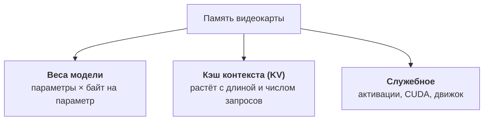
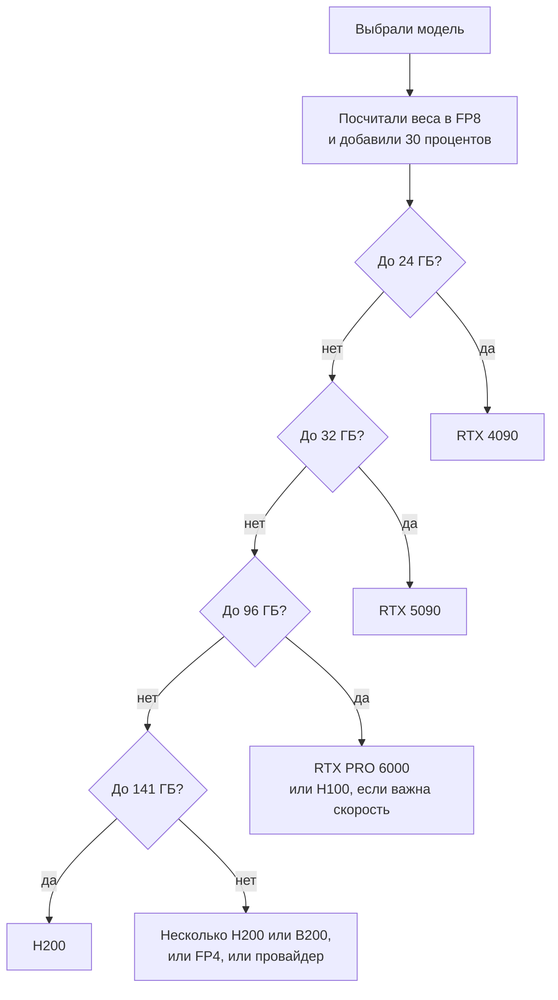

:::tldr
Сначала модель должна поместиться: веса плюс кэш контекста плюс запас. Веса считаются просто: число параметров умножить на размер одного параметра (2 байта в BF16, 1 в FP8, половина в FP4). Скорость генерации ограничена скоростью памяти: каждый новый токен требует прочитать все активные веса. Поэтому из двух видеокарт с одинаковой памятью быстрее та, у которой выше пропускная способность, а MoE-модели с малым числом активных параметров генерируют в разы быстрее плотных того же размера.
:::

## Два этапа генерации

Ответ модели складывается из двух этапов, и у них разные узкие места.

**Префилл.** Модель читает весь ваш запрос: системный промпт, историю, документы. Все токены запроса обрабатываются разом, большими матричными умножениями. Здесь видеокарта упирается в вычислительную мощность. От этого этапа зависит, сколько ждать первого токена.

**Декод.** Модель генерирует ответ по одному токену. Для каждого токена нужно прочитать из памяти все активные веса модели, а посчитать с ними нужно совсем немного. Видеокарта большую часть времени ждёт память. От этого этапа зависит, как быстро идёт текст.

В чатах и агентах большая часть времени уходит на декод, поэтому главная характеристика видеокарты для инференса это **пропускная способность памяти**, а не терафлопсы из маркетинговых таблиц.

::news{topic="gpu"}

## Сколько памяти нужно

Память видеокарты делится на три части.

### Веса

Число параметров умножается на размер одного параметра в выбранном формате:

| Формат | Байт на параметр | 27B модель | 120B модель |
|---|---|---|---|
| BF16 (исходный) | 2 | 54 ГБ | 240 ГБ |
| FP8 | 1 | 27 ГБ | 120 ГБ |
| FP4 / INT4 | около 0,5 | около 15 ГБ | около 65 ГБ |

Для MoE-моделей (Mixture of Experts) считается **общее** число параметров, а не активное. Модель на 35B параметров, из которых на каждый токен работают 3B, всё равно должна целиком лежать в памяти.

### Кэш контекста

Для каждого токена в контексте модель хранит ключи и значения внимания на каждом слое. Это KV-кэш, и он растёт линейно с длиной контекста и с числом одновременных запросов. Для классического внимания размер на один токен:

> KV на токен = 2 × число слоёв × число KV-голов × размер головы × байт на значение

Все эти числа есть в файле `config.json` модели на Hugging Face (`num_hidden_layers`, `num_key_value_heads`, `head_dim`). Для типичной плотной модели на 30B с 64 слоями, 8 KV-головами по 128 и кэшем в BF16 получается 256 КБ на токен. Один запрос на 32 тысячи токенов занимает 8 ГБ, а десять таких параллельно уже 80 ГБ, больше, чем сами веса.

Хорошие новости: современные модели борются с этим. Сжатое внимание (MLA у DeepSeek и Kimi), скользящее окно на части слоёв (Gemma), гибриды с линейным вниманием (Qwen3.5 и новее, Nemotron) уменьшают кэш в разы. Поэтому формула выше даёт оценку сверху. Точную цифру показывает сам движок при запуске: vLLM пишет в лог, сколько токенов кэша поместилось в память.

Кэш тоже можно хранить в FP8. Это вдвое увеличивает число токенов, которое помещается в ту же память, почти без потери качества.

### Правило на глаз

Возьмите размер весов в выбранном формате и добавьте к нему от 20 до 50 процентов. Двадцать, если контекст короткий и запросов мало. Пятьдесят и больше, если нужен длинный контекст и много параллельных пользователей. Если результат не влезает в одну видеокарту, есть три пути: формат поменьше, видеокарта побольше или несколько видеокарт.

## Какая будет скорость

Верхнюю границу скорости генерации для одного запроса можно прикинуть до запуска:

> токенов в секунду (максимум) ≈ пропускная способность памяти / размер активных весов

Плотная модель на 27B в FP8 весит 27 ГБ. У H100 SXM память читается со скоростью 3,35 ТБ/с, получается потолок около 120 токенов в секунду на один поток. Реально выходит 60 – 80 процентов от потолка.

MoE-модель на 35B с 3B активных параметров в том же FP8 на каждый токен читает около 3 ГБ, и её потолок уже около тысячи токенов в секунду. На практике её ограничат другие накладные расходы, но разница с плотной моделью всё равно кратная. Поэтому MoE так популярны для инференса: памяти нужно как у большой модели, а скорость как у маленькой.

При параллельных запросах веса читаются один раз на весь батч, и суммарная скорость растёт почти линейно, пока не упрётся в вычисления или в память под кэш. Именно поэтому в [первой части](/blog/ru/inference-concept/) загрузка видеокарты так сильно меняла цену токена.

## Форматы весов и поколения видеокарт

Модель обычно публикуют в BF16, а рядом выкладывают сжатые версии. Не каждый формат одинаково хорошо работает на каждой видеокарте.

| Формат | Где работает аппаратно | Когда брать |
|---|---|---|
| BF16 | везде, начиная с Ampere (A100, RTX 30xx) | когда память позволяет и нужен эталон качества |
| FP8 | Ada (RTX 40xx, L40S), Hopper (H100, H200), Blackwell | основной формат для серверного инференса: потери качества почти не видны |
| NVFP4, MXFP4 | Blackwell (B200, B300, RTX 50xx, RTX PRO 6000); MXFP4 у gpt-oss работает и на Hopper | когда нужно вместить большую модель; на Blackwell ещё и быстрее |
| AWQ, GPTQ (INT4) | любые видеокарты NVIDIA через оптимизированные ядра | старые и потребительские видеокарты, где нет FP8 |
| GGUF | llama.cpp и Ollama, в том числе CPU и Mac | локальный запуск и маленькие сервера, не для высокой нагрузки |

На A100 FP8 тоже запустится, но без аппаратной поддержки: веса хранятся в FP8 и экономят память, а считается всё в BF16. Работает, но скорости как на H100 не ждите.

Практический вывод: если видеокарта поддерживает FP8, берите FP8-версию модели от авторов. Её проверяли на качество, и она вдвое меньше исходной.

## Видеокарты, которые реально сдают в аренду

Цены ориентировочные, это прайс RunPod на начало ноября 2026 года за одну видеокарту в час. На Vast.ai те же карты часто дешевле, об этом в четвёртой части.

| Видеокарта | Память | Скорость памяти | FP8 / FP4 | Цена в час | Для чего |
|---|---|---|---|---|---|
| RTX 4090 | 24 ГБ | 1,0 ТБ/с | да / нет | около 0,9 доллара | модели до 14B в FP8, до 32B в INT4, картинки |
| RTX 5090 | 32 ГБ | 1,8 ТБ/с | да / да | около 1,2 доллара | модели до 27B в FP8 с коротким контекстом, картинки и видео |
| L40S | 48 ГБ | 0,86 ТБ/с | да / нет | около 1,1 доллара | много памяти за небольшие деньги, но медленная память |
| RTX PRO 6000 | 96 ГБ | 1,8 ТБ/с | да / да | около 2,5 доллара | лучшая цена за гигабайт; модели до 70B в FP8, MoE до 120B в FP4 |
| A100 80 ГБ | 80 ГБ | 2,0 ТБ/с | нет / нет | около 1,8 доллара | дёшево, но без FP8; подходит для BF16 и INT4 |
| H100 | 80 ГБ | 3,35 ТБ/с | да / нет | около 3 – 4 долларов | стандарт серверного инференса |
| H200 | 141 ГБ | 4,8 ТБ/с | да / нет | около 5,3 доллара | большие модели и длинный контекст на одной карте |
| B200 | 180 ГБ | 8 ТБ/с | да / да | около 8 долларов | самая быстрая генерация, крупные MoE в FP4 |
| B300 | 288 ГБ | 8 ТБ/с | да / да | около 9 долларов | ещё больше памяти на карту |

У AMD есть MI300X (192 ГБ, 5,3 ТБ/с) и более новые карты. vLLM и SGLang их поддерживают, но в аренде на RunPod и Vast.ai их мало, а готовых образов и оптимизаций под них меньше. Если не хотите разбираться с совместимостью, начните с NVIDIA.

## Несколько видеокарт

Если модель не помещается в одну видеокарту, её делят между несколькими. Самый частый способ, тензорный параллелизм: каждый слой режется на части, и видеокарты обмениваются результатами на каждом шаге. Это требует быстрой связи между ними.

- В серверах на H100, H200 и B200 карты соединены NVLink, и восемь карт работают почти как одна большая.
- Потребительские карты и RTX PRO 6000 связаны через PCIe. Две карты работают нормально, четыре уже заметно теряют на обмене.

Отсюда правило: **одна большая видеокарта лучше двух маленьких.** Две RTX 5090 в сумме дают 64 ГБ, но одна RTX PRO 6000 на 96 ГБ будет проще, быстрее на длинном контексте и почти не дороже.

Самые большие открытые модели живут только на серверах из восьми карт. Например, веса DeepSeek V4.1 Flash занимают около 510 ГБ, а Kimi K3 больше полутора терабайт. Такой сервер стоит 40 – 70 долларов в час, и это тот случай, когда провайдер с оплатой за токены почти всегда выгоднее.

## Как выбрать за пять минут

Две поправки к схеме. Если важна скорость ответа одному пользователю, поднимайтесь на ступень выше по скорости памяти: H100 вместо RTX PRO 6000. Если важна пропускная способность на много пользователей, считайте память под кэш щедрее: чем больше памяти остаётся после весов, тем больше запросов видеокарта обработает одновременно.

## Что дальше

Теперь мы умеем прикидывать, какая видеокарта нужна под модель. В [следующей части](/blog/ru/inference-models/) выбираем саму модель: какие открытые модели стоит запускать сейчас под разные задачи и бюджеты, и каким движком их обслуживать: vLLM, SGLang, llama.cpp или Ollama.
