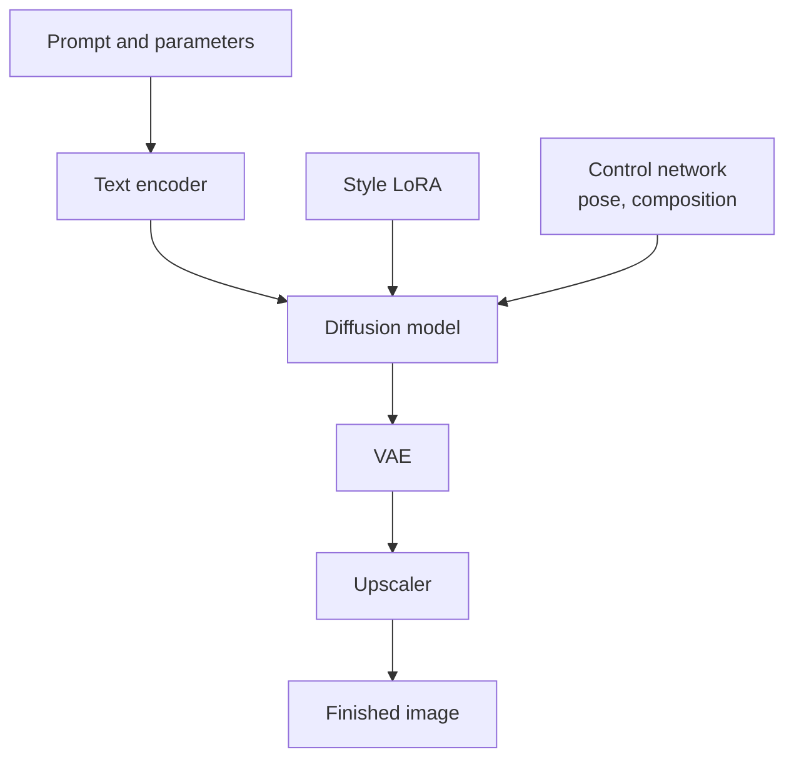
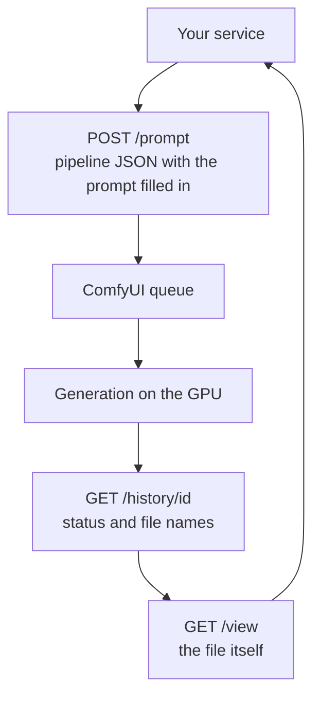

:::tldr
For images and video your own GPU beats an API more often than for text: pipelines with your own LoRAs and chains of models cannot be reproduced at providers. The standard tool here is ComfyUI: you build a pipeline with the mouse and then call it over HTTP. An RTX 4090 or 5090 is enough for images; video needs a 48 to 96 GB card. The main thing to check when choosing a model is the licence: many strong models are non-commercial.
:::

## How images differ from text

With language models everything comes down to one model and one engine. Images and video are different: the result comes from a chain of several models. A text encoder turns the prompt into vectors, a diffusion model draws, a VAE turns the result into pixels, and alongside them there may be LoRA adapters for a style or character, control networks that set pose or composition, an upscaler, background removal.

So instead of an engine like vLLM, people use a pipeline builder. The most common is [ComfyUI](https://www.comfy.org): you assemble a pipeline from nodes in the browser, and then call the same pipeline over an API. There are thousands of ready-made nodes and pipelines for ComfyUI, and almost every new model gets support in it within days of release.

One more difference: images and video don't benefit from batching as much as text does. A single generation usually occupies the whole GPU for seconds or minutes. So here it is more convenient to count seconds per generation rather than tokens.

::news{topic="media"}

## Which models to use now

Memory figures are approximate, as of early November 2026. They depend heavily on resolution, video length and weight format.

### Images

| Model | Size | Licence | Memory |
|---|---|---|---|
| Qwen-Image (2.x) | 7B | Apache 2.0 | 16 to 24 GB; accelerated 4 to 8 step versions exist |
| Z-Image Turbo | 6B | Apache 2.0 | from 16 GB, fast |
| FLUX.2 [klein] 4B | 4B | Apache 2.0 | about 8 GB |
| FLUX.2 [dev] | 32B | non-commercial; a product needs a BFL licence | about 32 GB in FP8 |
| Stable Diffusion 3.5 | up to 8B | free under a million dollars of annual revenue | 8 to 24 GB |

For your own product with commercial use, the simplest start is Qwen-Image or Z-Image Turbo: both are Apache 2.0, both handle complex prompts and text in images well, and there are already plenty of LoRAs and accelerated versions for them.

### Video

| Model | Size | Licence | Memory |
|---|---|---|---|
| Wan 2.2 TI2V-5B | 5B | Apache 2.0 | from 8 GB in GGUF, 24 GB in BF16; up to 720p |
| Wan 2.2 A14B | 27B, 14B active | Apache 2.0 | 40 to 48 GB for 720p at full quality |
| HunyuanVideo 1.5 | 8.3B | Tencent Community; commercial use below 100M monthly users | from 14 GB in FP8, 24 GB in FP16; up to 1080p |
| LTX-2.3 | 22B, video and audio | free for companies under 10 million dollars in revenue | from 16 GB in NVFP4 on Blackwell, 32 GB in FP8 |

Video is many times heavier than images: a few seconds of footage take minutes to generate even on an H100. If your product needs video often, count the money especially carefully; more on that in the [next part](/blog/inference-cost/).

Generation models change even faster than language models. New versions and accelerated variants appear in the feed above, and almost every such release comes with a ready-made ComfyUI pipeline.

## Which GPU

| Task | GPU |
|---|---|
| Images, experiments, LoRAs | RTX 4090 (24 GB) or RTX 5090 (32 GB) |
| Images in production, large models like FLUX.2 [dev] | RTX 5090, L40S or RTX PRO 6000 |
| Video up to 720p | RTX PRO 6000 (96 GB) or L40S (48 GB) |
| High-resolution video, long clips | H100, H200 |

Compute matters more for generation than for text, so the Blackwell RTX 5090 and RTX PRO 6000 are especially good value here. If a pipeline doesn't fit in memory, ComfyUI can offload parts to system RAM: the text encoder, for example, runs fine on the CPU. It is slower, but lets you get by with a smaller GPU.

## Bringing up ComfyUI

RunPod and Vast.ai have ready-made ComfyUI templates. The order is the same as with vLLM in [part five](/blog/inference-serve/):

1. **A network volume** of 100 to 300 GB. Image models, and video models especially, are large, and LoRAs and nodes pile up. ComfyUI and everything downloaded should live on the volume.
2. **A pod from the ComfyUI template** with the volume attached. The web interface port is usually 8188.
3. **Models** go into folders inside `ComfyUI/models`: diffusion models, text encoders, VAE, LoRAs. The ready-made pipelines for new models in ComfyUI's templates tell you which files to download.
4. **Build the pipeline** in the browser and check that it gives the result you need.

:::warning
ComfyUI has no built-in authentication. If you expose port 8188 to the internet, anyone can generate on your GPU, and through third-party nodes even run code. Open the interface only through a tunnel or a password-protected proxy, and for the API put your own service with a key in front of ComfyUI.
:::

## The pipeline as an API

A finished pipeline can be exported in API format: JSON where each node and its parameters are spelled out. Your product then works with ComfyUI like this:

Your service takes the exported JSON, fills in the prompt, seed and size in the right nodes, sends it to `/prompt` and gets a job id. Progress can be followed over a websocket or by polling `/history`. When generation finishes, the file is fetched via `/view` and put into your storage.

A few practical tips:

- **Keep the pipeline JSON in the repository** next to the code. It is your "model": a change to the pipeline should go through like a code change.
- **Pin versions** of ComfyUI and third-party nodes. Updating a node can quietly change the result or break the pipeline.
- **ComfyUI has its own queue, but a simple one.** If there are many generations, keep your own job queue in the service, as in the [core of the automations series](/blog/automations-queue/), and send ComfyUI one or two jobs per GPU at a time.
- **There is serverless for uneven load.** RunPod has a ready-made serverless worker for ComfyUI: you send the pipeline JSON, the platform starts a worker, generates and returns the result. The cold start is longer than for text because there are several models.

## What one generation costs

The formula is the same as for tokens, only the unit differs:

> price per generation = hourly rental price / 3600 × seconds per generation

An image in 5 seconds on an RTX 5090 at 1.2 dollars an hour costs about 0.17 cents. A thousand such images cost less than two dollars, provided the GPU doesn't sit idle between them. A five-second clip that takes 4 minutes to generate on an H100 at 3 dollars an hour costs about 20 cents. Your numbers will differ: measure the generation time of your pipeline on the chosen GPU and compare it with API providers' prices for the same resolution and length.

## What's next

In the [final part](/blog/inference-cost/) we bring everything about money together: how to calculate the real cost of your own model including idle time, when it pays to keep the GPU on permanently, when to shut it down when idle, and when to move to serverless.
