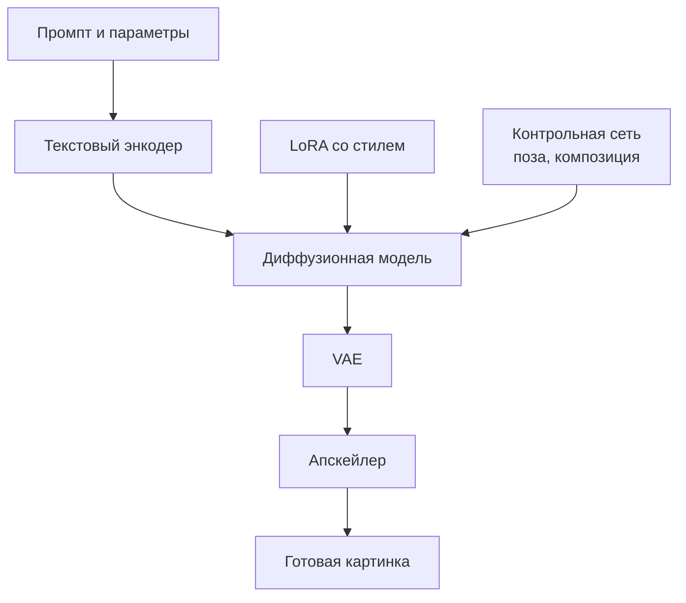
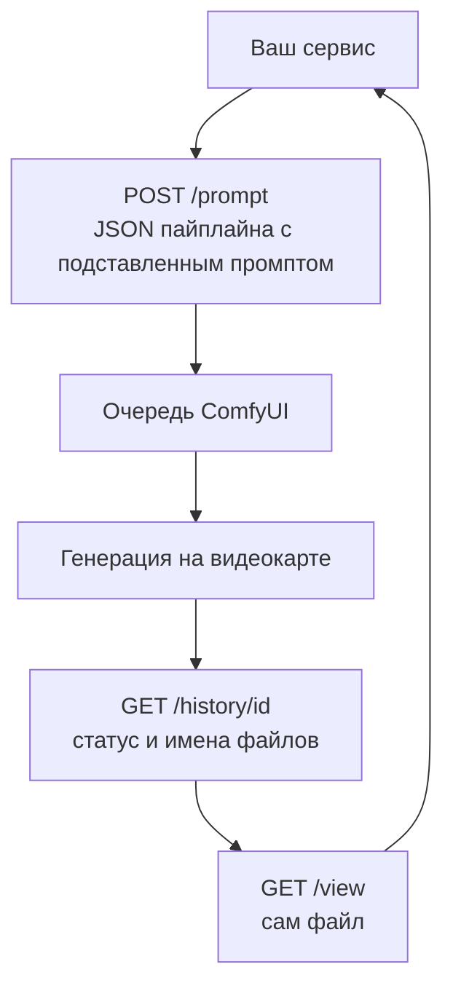

:::tldr
Для картинок и видео своя видеокарта выгоднее API чаще, чем для текста: пайплайны со своими LoRA и цепочками моделей у провайдеров не повторить. Стандартный инструмент здесь ComfyUI: в нём собирают пайплайн мышкой, а потом вызывают его по HTTP. Для картинок хватает RTX 4090 или 5090, для видео нужна карта на 48 – 96 ГБ. Главное, на что смотреть при выборе модели, это лицензия: у многих сильных моделей она некоммерческая.
:::

## Чем картинки отличаются от текста

С языковыми моделями всё сводится к одной модели и одному движку. С картинками и видео иначе: результат получается цепочкой из нескольких моделей. Текстовый энкодер превращает промпт в векторы, диффузионная модель рисует, VAE переводит результат в пиксели, а рядом могут работать LoRA-адаптеры со стилем или персонажем, контрольные сети, которые задают позу или композицию, апскейлер, удаление фона.

Поэтому вместо движка вроде vLLM здесь используют конструктор пайплайнов. Самый распространённый [ComfyUI](https://www.comfy.org): пайплайн собирается из узлов в браузере, а потом тот же пайплайн можно вызывать по API. Под ComfyUI есть тысячи готовых узлов и пайплайнов, и почти каждая новая модель получает поддержку в нём в первые дни после выхода.

Ещё одно отличие: картинки и видео не выигрывают от батчинга так сильно, как текст. Одна генерация обычно загружает видеокарту целиком на несколько секунд или минут. Поэтому считать здесь удобнее не токены, а секунды на одну генерацию.

::news{topic="media"}

## Какие модели брать сейчас

Цифры памяти ориентировочные, на начало ноября 2026 года. Они сильно зависят от разрешения, длины видео и формата весов.

### Картинки

| Модель | Размер | Лицензия | Память |
|---|---|---|---|
| Qwen-Image (2.x) | 7B | Apache 2.0 | 16 – 24 ГБ; есть ускоренные версии на 4 – 8 шагов |
| Z-Image Turbo | 6B | Apache 2.0 | от 16 ГБ, быстрая |
| FLUX.2 [klein] 4B | 4B | Apache 2.0 | около 8 ГБ |
| FLUX.2 [dev] | 32B | некоммерческая, для продукта нужна лицензия BFL | около 32 ГБ в FP8 |
| Stable Diffusion 3.5 | до 8B | бесплатно при выручке до миллиона долларов в год | 8 – 24 ГБ |

Для собственного продукта с коммерческим использованием проще всего начать с Qwen-Image или Z-Image Turbo: обе под Apache 2.0, хорошо понимают сложные промпты и текст на картинке, и для них уже много LoRA и ускоренных версий.

### Видео

| Модель | Размер | Лицензия | Память |
|---|---|---|---|
| Wan 2.2 TI2V-5B | 5B | Apache 2.0 | от 8 ГБ в GGUF, 24 ГБ в BF16; до 720p |
| Wan 2.2 A14B | 27B, из них 14B активных | Apache 2.0 | 40 – 48 ГБ для 720p в полном качестве |
| HunyuanVideo 1.5 | 8,3B | Tencent Community, коммерческое использование до 100 млн пользователей в месяц | от 14 ГБ в FP8, 24 ГБ в FP16; до 1080p |
| LTX-2.3 | 22B, видео и звук | бесплатно для компаний с выручкой до 10 млн долларов | от 16 ГБ в NVFP4 на Blackwell, 32 ГБ в FP8 |

Видео в разы тяжелее картинок: несколько секунд ролика генерируются минутами даже на H100. Если видео в продукте нужно часто, считайте деньги особенно внимательно, об этом в [следующей части](/blog/ru/inference-cost/).

Модели для генерации меняются ещё быстрее языковых. Новые версии и ускоренные варианты попадают в ленту выше, и почти каждый такой релиз сопровождается готовым пайплайном для ComfyUI.

## Какая видеокарта

| Задача | Видеокарта |
|---|---|
| Картинки, эксперименты, LoRA | RTX 4090 (24 ГБ) или RTX 5090 (32 ГБ) |
| Картинки в продакшене, крупные модели вроде FLUX.2 [dev] | RTX 5090, L40S или RTX PRO 6000 |
| Видео до 720p | RTX PRO 6000 (96 ГБ) или L40S (48 ГБ) |
| Видео в высоком разрешении, длинные ролики | H100, H200 |

Для генерации важнее, чем для текста, вычислительная мощность, поэтому RTX 5090 и RTX PRO 6000 на Blackwell здесь особенно хороши по цене. Если пайплайн не влезает в память, ComfyUI умеет выгружать части в оперативную память: текстовый энкодер, например, спокойно работает на процессоре. Это медленнее, но позволяет обойтись видеокартой поменьше.

## Поднимаем ComfyUI

На RunPod и Vast.ai есть готовые шаблоны с ComfyUI. Порядок такой же, как с vLLM в [пятой части](/blog/ru/inference-serve/):

1. **Сетевой том** на 100 – 300 ГБ. Модели для картинок и особенно для видео весят много, а LoRA и узлы накапливаются. ComfyUI и всё скачанное должно жить на томе.
2. **Под из шаблона ComfyUI** с подключённым томом. Порт веб-интерфейса обычно 8188.
3. **Модели** раскладываются по папкам внутри `ComfyUI/models`: диффузионные модели, текстовые энкодеры, VAE, LoRA. Готовые пайплайны для новых моделей в шаблонах ComfyUI сами подсказывают, какие файлы скачать.
4. **Собираем пайплайн** в браузере и проверяем, что он даёт нужный результат.

:::warning
У ComfyUI нет встроенной авторизации. Если открыть порт 8188 в интернет, любой сможет генерировать на вашей видеокарте, а через сторонние узлы и выполнять код. Открывайте интерфейс только через туннель или прокси с паролем, а для API ставьте перед ComfyUI свой сервис с ключом.
:::

## Пайплайн как API

Собранный пайплайн можно экспортировать в формате API: это JSON, где каждый узел и его параметры описаны явно. Дальше продукт работает с ComfyUI так:

Ваш сервис берёт экспортированный JSON, подставляет в нужные узлы промпт, сид, размер, отправляет его в `/prompt` и получает идентификатор задачи. Прогресс можно слушать по веб-сокету или периодически спрашивать `/history`. Когда генерация закончена, файл забирается через `/view` и складывается в ваше хранилище.

Несколько практических советов:

- **Храните JSON пайплайна в репозитории** рядом с кодом. Это и есть ваша «модель»: изменение пайплайна должно проходить как изменение кода.
- **Фиксируйте версии** ComfyUI и сторонних узлов. Обновление узла может незаметно поменять результат или сломать пайплайн.
- **Очередь у ComfyUI своя, но простая.** Если генераций много, держите свою очередь задач в сервисе, как в [ядре цикла про автоматизации](/blog/ru/automations-queue/), и отправляйте в ComfyUI по одной-две задачи на видеокарту.
- **Для неравномерной нагрузки есть serverless.** У RunPod есть готовый serverless-воркер для ComfyUI: вы отправляете JSON пайплайна, площадка поднимает воркер, генерирует и возвращает результат. Холодный старт здесь дольше, чем у текста, потому что моделей несколько.

## Сколько стоит одна генерация

Формула та же, что для токенов, только единица другая:

> цена генерации = цена часа аренды / 3600 × секунд на одну генерацию

Картинка за 5 секунд на RTX 5090 по 1,2 доллара в час стоит около 0,17 цента. Тысяча таких картинок меньше двух долларов, если видеокарта не простаивает между ними. Пятисекундный ролик, который генерируется 4 минуты на H100 по 3 доллара в час, стоит около 20 центов. Ваши цифры будут другими: замерьте время генерации своего пайплайна на выбранной видеокарте и сравните с ценой API-провайдеров за то же разрешение и длину.

## Что дальше

В [последней части](/blog/ru/inference-cost/) собираем всё про деньги: как посчитать реальную стоимость своей модели с учётом простоя, когда выгодно держать видеокарту включённой постоянно, когда гасить её по простою, а когда переходить на serverless.
