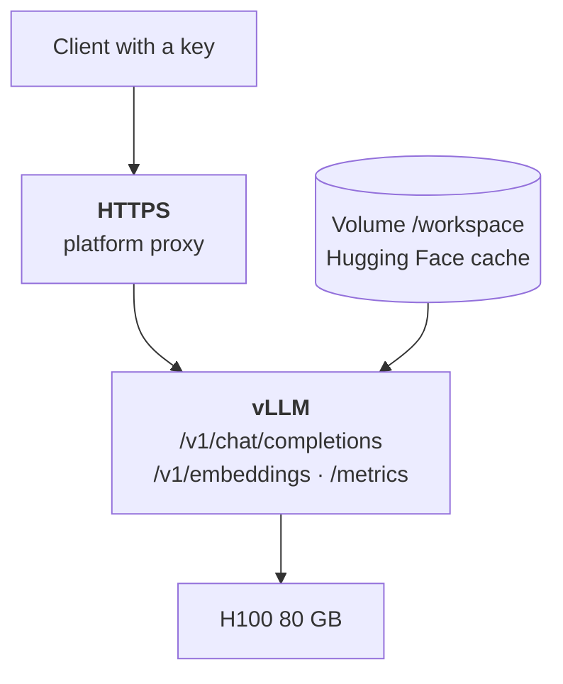

:::tldr
The server comes up with one command: the official vLLM image, an FP8 model from a persistent disk, a context limit and an access key. After that the main thing is not launching but measuring: run a load test at different numbers of parallel requests, find the point where latency is still acceptable and throughput is already high, and use it to compute the price of a million tokens. The endpoint plugs into a product by changing the address and key in any OpenAI-compatible client.
:::

## What we run

We take a typical option from [part three](/blog/inference-models/): Qwen3.8-27B in FP8 on a single 80 to 96 GB GPU, for example an H100 or an RTX PRO 6000 on RunPod. Everything below works the same with another model and on Vast.ai; only the model name and a couple of numbers change.



::news{topic="inference"}

## Step 1. A pod with a volume

Create a 100 to 200 GB network volume in a data centre that has the GPU you need, and a pod on it. How to choose the platform and data centre is covered in [part four](/blog/inference-clouds/). Pod settings:

| Field | Value |
|---|---|
| Image | `vllm/vllm-openai:v0.33.0` (pin the version, not `latest`) |
| Volume | the network volume, mounted at `/workspace` |
| Variables | `HF_HOME=/workspace/hf`, `HF_TOKEN=<Hugging Face token>`, `VLLM_API_KEY=<long random key>` |
| Port | 8000, HTTP |

`HF_HOME` points at the volume, so the weights are downloaded there once and survive pod deletion. The Hugging Face token is needed for models whose authors ask you to accept terms; for the rest it simply speeds up downloads.

## Step 2. The start command

The vLLM image runs `vllm serve`; we just pass the arguments:

```bash
vllm serve Qwen/Qwen3.8-27B-FP8 \
  --served-model-name qwen \
  --max-model-len 65536 \
  --gpu-memory-utilization 0.92 \
  --kv-cache-dtype fp8
```

vLLM reads the access key from the `VLLM_API_KEY` variable, so it isn't in the command and won't end up in history or logs. What the other parameters do:

| Parameter | Why |
|---|---|
| `--served-model-name qwen` | a short model name for clients; you can swap the model without touching code |
| `--max-model-len 65536` | maximum context length. The default comes from the model and may be huge: then one request's cache takes all the memory. Set as much as you actually need |
| `--gpu-memory-utilization 0.92` | the share of GPU memory vLLM takes for weights and cache |
| `--kv-cache-dtype fp8` | an FP8 cache: twice as many tokens fit |

Models with tool calling and reasoning need a couple more flags: which parser extracts function calls, and where the model's reasoning ends. The exact values for each model are in its Hugging Face card and in the [vLLM recipes](https://docs.vllm.ai/projects/recipes/). Take them from there rather than guessing.

## Step 3. Read the startup log

The first start takes time to download the weights; later ones take a couple of minutes. When the server is ready, the log has two useful lines: how many cache tokens fit in memory, and how many maximum-length requests fit at once. Something like:

```text
GPU KV cache size: 412,000 tokens
Maximum concurrency for 65,536 tokens per request: 6.3x
```

These numbers are illustrative; yours will differ. The meaning is: if every request were 64 thousand tokens long, only six would fit at once. Real requests are usually shorter, so more will run in parallel, but if your task involves long documents this line immediately shows whether the GPU is enough.

If the server fails to start with an out-of-memory error, reduce `--max-model-len` or take a bigger GPU.

## Step 4. Check it

On RunPod the address looks like `https://<pod-id>-8000.proxy.runpod.net`:

```bash
curl https://<address>/v1/chat/completions \
  -H "Authorization: Bearer $VLLM_API_KEY" \
  -H "Content-Type: application/json" \
  -d '{"model": "qwen", "messages": [{"role": "user", "content": "Hi! Who are you?"}]}'
```

Without the key header the server should answer 401. Check that too: it is the only thing between your GPU and the entire internet.

## Step 5. Measure speed

This is the most important step. "The model does 80 tokens per second" says nothing about price until you know at how many parallel requests it was measured. vLLM has a built-in load test; it is better run from a separate machine so the network is included:

```bash
OPENAI_API_KEY=$VLLM_API_KEY vllm bench serve \
  --base-url https://<address> --model qwen \
  --tokenizer Qwen/Qwen3.8-27B-FP8 \
  --dataset-name random --random-input-len 2000 --random-output-len 400 \
  --num-prompts 200 --max-concurrency 16
```

Pick input and output lengths to match your task: for document labelling the input is long and the output short; for chat it is the other way round. Run the test several times, changing `--max-concurrency`: 1, 4, 16, 64. You get a table worth filling in with your own numbers:

| Parallel requests | Time to first token | Speed per request | Total tokens per second |
|---|---|---|---|
| 1 | | | |
| 4 | | | |
| 16 | | | |
| 64 | | | |

How to read the result:

- **Time to first token (TTFT)** grows with load: requests queue for prefill. For chat, more than a couple of seconds is already noticeable.
- **Speed per request** (the inverse of TPOT, time per token) falls as parallelism grows, but slowly. People read at about 10 tokens per second; anything above 20 to 30 feels fast.
- **Total throughput** grows almost linearly until the GPU saturates. This is the number for the price formula.

The working point is the highest parallelism at which time to first token and per-request speed still meet your requirements. Batch processing has almost no latency requirements, so its working point is maximum total throughput.

Now plug the total throughput into the formula from [part one](/blog/inference-concept/) and you get the price of a million tokens on your GPU at your load. That number can be compared honestly with a provider's price.

## Step 6. Access

`VLLM_API_KEY` closes all API endpoints with one key. For a single service calling the model that is enough. A few more rules:

- **The key is long and random**, for example 32 bytes from a random number generator. It lives in the platform's and your service's secrets, not in code.
- **HTTPS only.** RunPod's proxy provides it straight away. On Vast.ai put Caddy in front of vLLM or use a tunnel.
- **Several clients and limits.** If different teams use the model and you need to track each one's usage, put a gateway such as LiteLLM in front of vLLM: it issues separate keys, counts tokens and rate-limits requests.
- **Metrics.** vLLM serves `/metrics` in Prometheus format: queue length, cache usage, token counts. Collect them at least to see GPU utilisation, because that is what the money depends on.

## Step 7. Connect it to the product

vLLM speaks the OpenAI API, so any client that can change its base URL will do. In TypeScript it is one setting:

```ts
import OpenAI from "openai";

const llm = new OpenAI({
  baseURL: "https://<address>/v1",
  apiKey: process.env.LLM_API_KEY,
});
```

After that it's ordinary `llm.chat.completions.create` calls with `model: "qwen"`. For labelling and data extraction, pass `response_format` with a JSON schema: vLLM will constrain generation to the schema and the model cannot return an invalid answer.

Recent vLLM versions also serve the Anthropic Messages API format (`/v1/messages`), so code written with the Anthropic SDK, as in the [agent series](/blog/series/company-agent/), can also be pointed at your own model by changing the address.

## What else you can tune

vLLM's defaults are sensible, and most people won't need anything else. If you hit a specific problem:

| Problem | What to try |
|---|---|
| Long wait for the first token on long requests | a shared prefix at the start of requests so prefix caching kicks in (on by default) |
| Slow for a single user | speculative decoding with a draft model or n-grams, if the model's authors recommend it |
| Not enough memory for cache | smaller `--max-model-len`, FP8 cache, a bigger GPU |
| The model doesn't fit on one GPU | `--tensor-parallel-size 2` or 4 on a multi-GPU machine |
| Too many parallel requests, latency grows | cap `--max-num-seqs`; extra requests wait in the queue |

## What's next

The language model is running. In the [next part](/blog/inference-media/) we bring up ComfyUI for images and video on the same platform: which generation models are worth using now, how much memory they need, and how to turn a ComfyUI pipeline into an API for your product.
