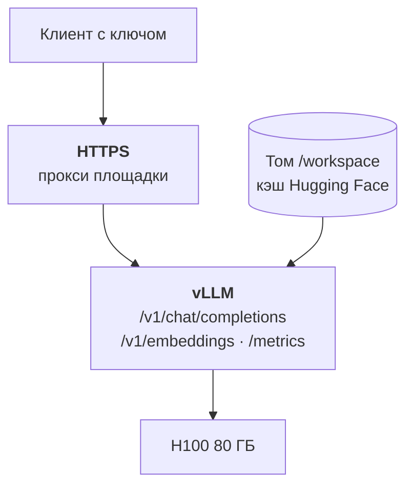

:::tldr
Сервер поднимается одной командой: официальный образ vLLM, модель в FP8 с постоянного диска, ограничение контекста и ключ доступа. Дальше главное не запуск, а замер: прогоните нагрузочный тест с разным числом параллельных запросов, найдите точку, где задержка ещё приемлема, а пропускная способность уже высокая, и посчитайте по ней цену миллиона токенов. К продукту эндпоинт подключается сменой адреса и ключа в любом OpenAI-совместимом клиенте.
:::

## Что запускаем

Возьмём типичный вариант из [третьей части](/blog/ru/inference-models/): Qwen3.8-27B в FP8 на одной видеокарте на 80 – 96 ГБ, например H100 или RTX PRO 6000 на RunPod. Всё ниже точно так же работает с другой моделью и на Vast.ai, меняются только имя модели и пара цифр.



::news{topic="inference"}

## Шаг 1. Под с томом

Создаём сетевой том на 100 – 200 ГБ в дата-центре, где есть нужная видеокарта, и под на нём. Как выбрать площадку и дата-центр, разобрано в [четвёртой части](/blog/ru/inference-clouds/). Настройки пода:

| Поле | Значение |
|---|---|
| Образ | `vllm/vllm-openai:v0.33.0` (фиксируйте версию, а не `latest`) |
| Том | сетевой том, подключённый в `/workspace` |
| Переменные | `HF_HOME=/workspace/hf`, `HF_TOKEN=<токен Hugging Face>`, `VLLM_API_KEY=<длинный случайный ключ>` |
| Порт | 8000, HTTP |

`HF_HOME` указывает на том, поэтому веса скачаются туда один раз и переживут удаление пода. Токен Hugging Face нужен для моделей, где автор просит принять условия; для остальных он просто ускоряет скачивание.

## Шаг 2. Команда запуска

Образ vLLM запускает `vllm serve`, нам остаётся передать аргументы:

```bash
vllm serve Qwen/Qwen3.8-27B-FP8 \
  --served-model-name qwen \
  --max-model-len 65536 \
  --gpu-memory-utilization 0.92 \
  --kv-cache-dtype fp8
```

Ключ доступа vLLM берёт из переменной `VLLM_API_KEY`, поэтому в команде его нет и он не попадёт в историю и логи. Что делают остальные параметры:

| Параметр | Зачем |
|---|---|
| `--served-model-name qwen` | короткое имя модели для клиентов; можно поменять модель, не трогая код |
| `--max-model-len 65536` | максимальная длина контекста. По умолчанию берётся из модели, и может оказаться огромной: тогда на кэш одного запроса уйдёт вся память. Ставьте столько, сколько реально нужно |
| `--gpu-memory-utilization 0.92` | какую долю памяти видеокарты vLLM заберёт себе под веса и кэш |
| `--kv-cache-dtype fp8` | кэш в FP8: помещается вдвое больше токенов |

Модели с вызовом инструментов и рассуждениями требуют ещё пару флагов: какой парсер разбирает вызовы функций и где у модели заканчиваются рассуждения. Конкретные значения для каждой модели есть в её карточке на Hugging Face и в [сборнике рецептов vLLM](https://docs.vllm.ai/projects/recipes/). Берите оттуда, а не угадывайте.

## Шаг 3. Читаем лог запуска

Первый запуск займёт время на скачивание весов, следующие пару минут. Когда сервер готов, в логе есть две полезные строки: сколько токенов кэша поместилось в память и сколько запросов максимальной длины влезет одновременно. Примерно так:

```text
GPU KV cache size: 412,000 tokens
Maximum concurrency for 65,536 tokens per request: 6.3x
```

Цифры здесь условные, у вас будут свои. Смысл такой: если все запросы будут длиной 64 тысячи токенов, одновременно поместятся только шесть. Реальные запросы обычно короче, поэтому параллельных будет больше, но если в вашей задаче длинные документы, эта строка сразу покажет, хватит ли видеокарты.

Если сервер не стартует с ошибкой нехватки памяти, уменьшайте `--max-model-len` или берите видеокарту побольше.

## Шаг 4. Проверяем

На RunPod адрес будет вида `https://<id-пода>-8000.proxy.runpod.net`:

```bash
curl https://<адрес>/v1/chat/completions \
  -H "Authorization: Bearer $VLLM_API_KEY" \
  -H "Content-Type: application/json" \
  -d '{"model": "qwen", "messages": [{"role": "user", "content": "Привет! Ты кто?"}]}'
```

Без заголовка с ключом сервер должен отвечать 401. Проверьте это тоже: это единственное, что отделяет вашу видеокарту от всего интернета.

## Шаг 5. Замер скорости

Это самый важный шаг. Фраза «модель выдаёт 80 токенов в секунду» ничего не говорит о цене, пока не известно, при скольких параллельных запросах она получена. В vLLM встроен нагрузочный тест, запускать его удобнее с отдельной машины, чтобы учитывать и сеть:

```bash
OPENAI_API_KEY=$VLLM_API_KEY vllm bench serve \
  --base-url https://<адрес> --model qwen \
  --tokenizer Qwen/Qwen3.8-27B-FP8 \
  --dataset-name random --random-input-len 2000 --random-output-len 400 \
  --num-prompts 200 --max-concurrency 16
```

Длины входа и выхода подберите под свою задачу: для разметки документов вход длинный, а выход короткий, для чата наоборот. Прогоните тест несколько раз, меняя `--max-concurrency`: 1, 4, 16, 64. Получится таблица, которую стоит заполнить своими цифрами:

| Параллельных запросов | Время до первого токена | Скорость на один запрос | Суммарно токенов в секунду |
|---|---|---|---|
| 1 | | | |
| 4 | | | |
| 16 | | | |
| 64 | | | |

Как читать результат:

- **Время до первого токена (TTFT)** растёт с нагрузкой: запросы ждут очереди на префилл. Для чата больше пары секунд уже заметно.
- **Скорость на один запрос** (обратная к TPOT, времени на токен) падает с ростом параллельности, но медленно. Человек читает около 10 токенов в секунду, всё что выше 20 – 30 воспринимается как быстро.
- **Суммарная скорость** растёт почти линейно, пока видеокарта не насытится. Это и есть число для формулы цены.

Рабочая точка это наибольшая параллельность, при которой время до первого токена и скорость на запрос ещё укладываются в ваши требования. Для пакетной обработки требований к задержке почти нет, и рабочей точкой становится максимум суммарной скорости.

Теперь подставьте суммарную скорость в формулу из [первой части](/blog/ru/inference-concept/) и получите цену миллиона токенов на вашей видеокарте при вашей нагрузке. Это число уже можно честно сравнивать с ценой провайдера.

## Шаг 6. Доступ

`VLLM_API_KEY` закрывает все эндпоинты API одним ключом. Для одного сервиса, который ходит в модель, этого достаточно. Ещё несколько правил:

- **Ключ длинный и случайный**, например 32 байта из генератора случайных чисел. Хранится в секретах площадки и вашего сервиса, не в коде.
- **Только HTTPS.** Прокси RunPod даёт его сразу. На Vast.ai поставьте перед vLLM Caddy или используйте туннель.
- **Несколько клиентов и лимиты.** Если моделью пользуются разные команды и нужно считать расход по каждой, поставьте перед vLLM шлюз вроде LiteLLM: он выдаёт отдельные ключи, считает токены и ограничивает частоту запросов.
- **Метрики.** vLLM отдаёт `/metrics` в формате Prometheus: длина очереди, использование кэша, число токенов. Их стоит собирать хотя бы для того, чтобы видеть загрузку видеокарты, от неё зависят деньги.

## Шаг 7. Подключаем к продукту

vLLM говорит на языке OpenAI API, поэтому подойдёт любой клиент, который умеет менять базовый адрес. На TypeScript это одна настройка:

```ts
import OpenAI from "openai";

const llm = new OpenAI({
  baseURL: "https://<адрес>/v1",
  apiKey: process.env.LLM_API_KEY,
});
```

Дальше обычные вызовы `llm.chat.completions.create` с `model: "qwen"`. Для разметки и извлечения данных передавайте `response_format` с JSON-схемой: vLLM ограничит генерацию схемой, и модель не сможет вернуть невалидный ответ.

Свежие версии vLLM отдают и формат Anthropic Messages API (`/v1/messages`), так что код, написанный на SDK Anthropic, как в [цикле про агента](/blog/ru/series/company-agent/), тоже можно направить на свою модель сменой адреса.

## Что ещё можно подкрутить

Настройки по умолчанию у vLLM разумные, и большинству ничего больше не понадобится. Если упёрлись в конкретную проблему:

| Проблема | Что пробовать |
|---|---|
| Долго ждать первого токена на длинных запросах | общий префикс в начале запросов, чтобы работал кэш префиксов (включён по умолчанию) |
| Медленно для одного пользователя | спекулятивное декодирование с моделью-черновиком или n-граммами, если авторы модели его рекомендуют |
| Не хватает памяти под кэш | меньше `--max-model-len`, кэш в FP8, видеокарта больше |
| Модель не влезает в одну видеокарту | `--tensor-parallel-size 2` или 4 на машине с несколькими картами |
| Слишком много параллельных запросов, растёт задержка | ограничить `--max-num-seqs`, лишние запросы подождут в очереди |

## Что дальше

Языковая модель работает. В следующей части поднимаем на той же площадке ComfyUI для картинок и видео: какие модели генерации стоит брать сейчас, сколько им нужно памяти и как превратить пайплайн из ComfyUI в API для своего продукта.
