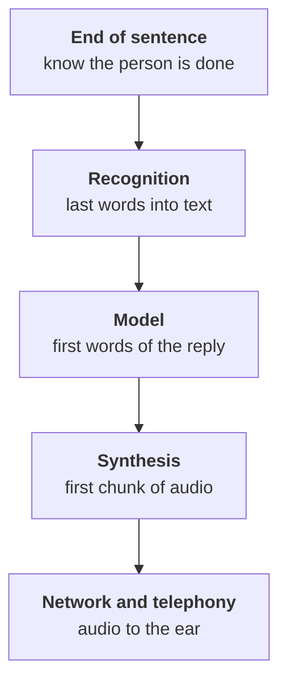
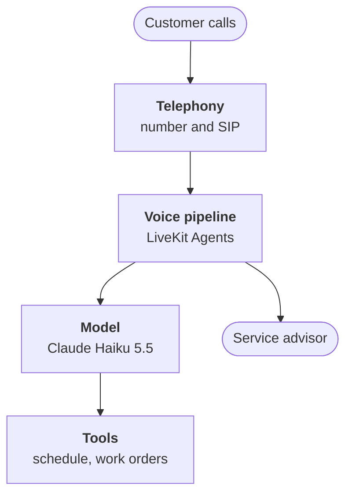

:::tldr
A voice agent pays off on frequent, repetitive calls with a clear outcome: book, reschedule, check a status. It does not replace people entirely; it takes the routine off them and honestly hands everything else to a human. There are two architectures: a cascade, where speech first becomes text, then the model writes a reply, then synthesis speaks it, and speech-to-speech models that listen and talk on their own. For a business with tools and audit requirements we pick the cascade: each part can be replaced, measured and tested. The main enemy in any architecture is latency: if more than a second passes between the end of the person's sentence and the start of the reply, the conversation falls apart.
:::

## Calls nobody wants to take

Take the series' running example: a chain of six car service stations. About four hundred calls a day, answered by service advisors who at the same moment have a customer standing at the desk. Sort a week of calls by topic and you get a typical picture:

| Topic | Share | What the answer needs |
|---|---|---|
| Book a service or repair | 35% | free slots in the schedule |
| Reschedule or cancel | 10% | find the booking by phone |
| Where is my car, is it ready | 20% | the work order status |
| Address, hours, price of a service | 15% | a reference sheet and price list |
| A hard question, complaint, haggling | 20% | a live person |

Four out of five calls are solved with data the service already has in its systems. They do not need an advisor's experience, they need fast access to the schedule and work orders. That is voice agent territory. The last row, hard conversations, stays with people, and the agent must be able to pass them over quickly and politely.

::news{topic="voice"}

## Where the agent pays off and where it does not

Good candidates look alike:

- **Many identical calls.** Dozens or hundreds a day on a few topics.
- **A clear outcome.** The call ends with a booking, a reschedule or an answer to a specific question.
- **Data available through an API.** The schedule, CRM or back-office system can return and accept data.
- **Calls get lost.** Nobody picks up at peak hours, in the evening and on weekends, and the customer goes next door.

Bad candidates are easy to spot too: sales with hard haggling, conversations where empathy and responsibility matter (complaints, medical concerns), and processes that are not described even for people. If employees decide differently every time, the agent will not decide better.

An honest goal looks like this: the agent closes half to two thirds of calls by itself, never leaves a person without an answer and hands the rest to a human with a short summary of the conversation. Not "replace the call center", but take the routine off people and stop losing evening calls.

## Cascade or speech-to-speech

Today you can build a voice agent in two ways.

**Cascade.** Three models in turn: speech recognition turns the voice into text, a language model writes the reply and calls tools, speech synthesis speaks the reply. All three stream, so none waits for the previous one to finish entirely: synthesis starts speaking the first sentence while the model writes the second.

**Speech-to-speech.** One model that listens to audio and answers with audio, like OpenAI Realtime or Gemini Live. It hears intonation, can answer faster and handles interruptions more naturally.

| | Cascade | Speech-to-speech |
|---|---|---|
| Latency | about a second when built well | faster |
| Voice and language | any synthesis, your own voice | the provider's voices |
| Tools | reliable, like a text model | work, but weaker |
| Log | text of every turn out of the box | needs separate transcription |
| Swapping parts | each one separately | only all at once |
| Cost | cheaper, especially with open models | more per minute |

For a business agent that must book customers into a schedule, speak in a chosen voice and leave a clear log, we take the cascade. It is a fraction of a second slower, but each link can be measured, replaced and tested on its own. Speech-to-speech models are catching up fast, and the series' architecture lets you move to them if needed: the tools and conversation logic stay the same.

## The second that decides everything

In live conversation people answer each other almost without a pause, usually within two to five hundred milliseconds. If the pause is longer than a second, the other side starts asking "hello?", and if the agent answers after two, the conversation turns into a walkie-talkie. So latency is not something to reduce when possible; it is a budget to plan from day one.

Latency is the time from the moment the person stops talking to the first sound of the reply. It is made of several parts:

A rough budget for a good build, order-of-magnitude numbers:

| Link | Milliseconds |
|---|---|
| Detect the end of the turn | 200 – 400 |
| Finish recognizing the last words | 50 – 150 |
| First model tokens | 250 – 500 |
| First synthesized audio | 80 – 200 |
| Network and telephony | 100 – 200 |
| Total | 700 – 1400 |

The table shows the main point: no link can afford to be slow. A large model that thinks for two seconds before answering breaks the conversation however smart its answer. That is why voice uses fast models like Claude Haiku 5.5, short prompts with caching and streaming at every step. Each part of the budget gets its own article in the series.

## What the agent is made of

**Telephony.** A number from a carrier and a SIP trunk that delivers calls to us. Handing a call over to a human also lives here.

**Voice pipeline.** LiveKit Agents: an open framework that takes in audio, passes it to recognition, decides when the person is done, calls the model, sends the reply to synthesis and handles interruptions. It handles both SIP calls and browser conversations, which is handy for testing.

**Model.** The agent's brain: understands what the customer wants, asks clarifying questions and calls tools. It is the same agent loop as in the [company agent series](/blog/agent-loop/), only the replies are shorter and spoken.

**Tools.** Find a free slot, book, find a booking by phone, check a car's status, hand over to a human. They reach the service's systems through an API.

**Log and recordings.** Every turn as text, the latency of every link, tool calls and the call outcome. Without this you cannot understand why the agent made a mistake or prove that it works.

## Principles

1. **The agent introduces itself honestly.** The first sentence says it is a voice assistant. It is polite, removes irritation and is mandatory in many countries.
2. **A human is always one sentence away.** "Put me through to an advisor" works at any step of the conversation.
3. **Short turns.** One thought, one question. No six-item lists by voice.
4. **Confirm before acting.** The agent reads back the date, time and car and waits for "yes".
5. **Latency is a budget.** We measure every link separately and know what it costs.
6. **Record everything.** Text, audio, latency, tools, outcome. With permission and a limited retention period.

## What we will build

1. This part: where the agent pays off, the cascade and the latency budget.
2. [The cascade](/blog/voice-pipeline/): pick recognition, the model and synthesis and assemble them into a streaming pipeline.
3. [Live dialogue](/blog/voice-turns/): how to tell the person is done and what to do when they interrupt.
4. [Telephony](/blog/voice-phone/): a number, a SIP trunk, phone audio quality and handing over to a human.
5. [Actions](/blog/voice-tools/): tools for the schedule and work orders, confirming by voice, dates and plates.
6. [Quality](/blog/voice-quality/): simulated calls, metrics and a weekly review of recordings.
7. [To production](/blog/voice-prod/): load, the cost of a minute, own models or cloud, personal data.

## What's next

In the [second part](/blog/voice-pipeline/) we assemble the cascade itself: pick speech recognition and synthesis models for the language and phone audio, connect the model and make everything stream so the first sentence of the reply is heard in under a second.
