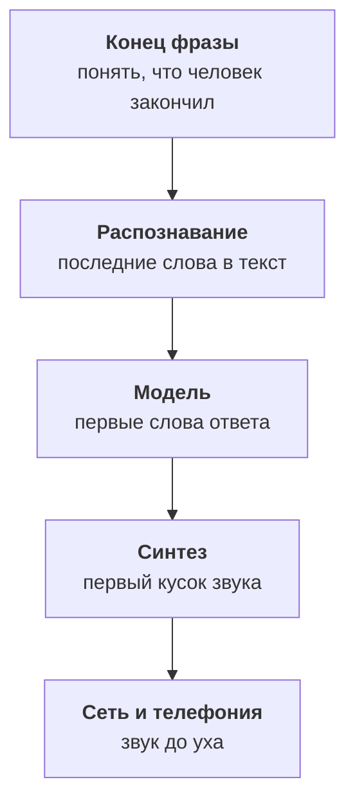
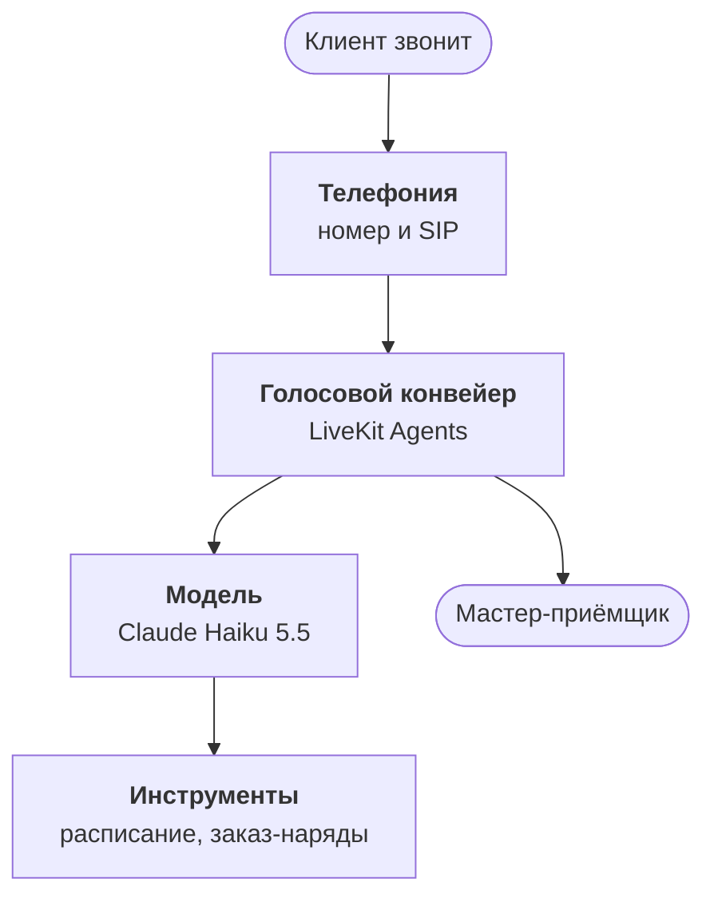

:::tldr
Голосовой агент окупается на частых однотипных звонках с понятным исходом: записаться, перенести, узнать статус. Он не заменяет людей целиком, а снимает с них рутину и честно переводит на человека всё остальное. Архитектур две: каскад, где речь сначала превращается в текст, потом модель пишет ответ, потом синтез его озвучивает, и модели речь-в-речь, которые слушают и говорят сами. Для бизнеса с инструментами и требованиями к журналу мы выбираем каскад: каждую часть можно заменить, измерить и проверить. Главный враг в любой архитектуре это задержка: если между концом фразы человека и началом ответа проходит больше секунды, разговор разваливается.
:::

## Звонки, которые никто не хочет брать

Возьмём сквозной пример цикла: сеть из шести автосервисов. Около четырёхсот звонков в день, на них отвечают мастера-приёмщики, у которых в это же время перед стойкой стоит клиент. Если разложить звонки по темам за неделю, картина получается типичной:

| Тема | Доля | Что нужно для ответа |
|---|---|---|
| Записаться на ТО или ремонт | 35% | свободные окна в расписании |
| Перенести или отменить запись | 10% | найти запись по телефону |
| Где моя машина, готова ли | 20% | статус заказ-наряда |
| Адрес, часы работы, цена услуги | 15% | справочник и прайс |
| Сложный вопрос, претензия, торг | 20% | живой человек |

Четыре из пяти звонков решаются данными, которые уже есть в системах сервиса. Для ответа не нужен опыт мастера, нужен быстрый доступ к расписанию и заказ-нарядам. Это и есть территория голосового агента. Последняя строчка, сложные разговоры, остаётся людям, и агент должен уметь быстро и вежливо их туда передать.

::news{topic="voice"}

## Где агент окупается, а где нет

Хорошие кандидаты похожи друг на друга:

- **Много одинаковых звонков.** Десятки и сотни в день по нескольким темам.
- **Понятный исход.** Звонок заканчивается записью, переносом или ответом на конкретный вопрос.
- **Данные доступны по API.** Расписание, CRM или учётная система умеют отдавать и принимать данные.
- **Звонки теряются.** Не берут трубку в часы пик, вечером и в выходные, и клиент уходит к соседям.

Плохие кандидаты тоже узнаются сразу: продажи со сложным торгом, разговоры, где важна эмпатия и ответственность (претензии, медицинские жалобы), и процессы, которые не описаны даже для людей. Если сотрудники сами каждый раз решают по-разному, агент не решит лучше.

Честная цель выглядит так: агент сам закрывает половину или две трети звонков, никогда не оставляет человека без ответа и передаёт остальное человеку с кратким пересказом разговора. Не «заменить колл-центр», а снять с людей рутину и перестать терять звонки вечером.

## Каскад или речь-в-речь

Голосового агента сегодня можно собрать двумя способами.

**Каскад.** Три модели по очереди: распознавание речи превращает голос в текст, языковая модель пишет ответ и вызывает инструменты, синтез речи озвучивает ответ. Все три работают потоково, то есть не ждут друг друга целиком: синтез начинает говорить первое предложение, пока модель пишет второе.

**Речь-в-речь.** Одна модель, которая сама слушает звук и сама отвечает звуком, как OpenAI Realtime или Gemini Live. Она слышит интонацию, может ответить быстрее и естественнее перебивается.

| | Каскад | Речь-в-речь |
|---|---|---|
| Задержка | около секунды при хорошей сборке | быстрее |
| Голос и язык | любой синтез, свой голос | голоса провайдера |
| Инструменты | надёжные, как у текстовой модели | работают, но слабее |
| Журнал | текст каждой реплики из коробки | нужно расшифровывать отдельно |
| Замена частей | каждую по отдельности | только целиком |
| Стоимость | дешевле, особенно с открытыми моделями | дороже за минуту |

Для бизнес-агента, который должен записывать клиентов в расписание, говорить по-русски выбранным голосом и оставлять понятный журнал, мы берём каскад. Он медленнее на доли секунды, но каждое звено можно измерить, заменить и проверить отдельно. Модели речь-в-речь быстро догоняют, и архитектура цикла позволит перейти на них, если понадобится: инструменты и логика разговора останутся теми же.

## Секунда, которая всё решает

В живом разговоре люди отвечают друг другу почти без паузы, обычно за двести – пятьсот миллисекунд. Если пауза дольше секунды, собеседник начинает переспрашивать «алло?», а если агент отвечает через две, разговор превращается в рацию. Поэтому задержку нужно не уменьшать по возможности, а планировать с первого дня, как бюджет.

Задержка это время от момента, когда человек замолчал, до первого звука ответа. Она складывается из нескольких частей:

Примерный бюджет для хорошей сборки, цифры порядка величины:

| Звено | Миллисекунды |
|---|---|
| Определить конец реплики | 200 – 400 |
| Дораспознать последние слова | 50 – 150 |
| Первые токены модели | 250 – 500 |
| Первый звук синтеза | 80 – 200 |
| Сеть и телефония | 100 – 200 |
| Итого | 700 – 1400 |

Из таблицы видно главное: никакое звено не может позволить себе быть медленным. Большая модель, которая думает две секунды перед ответом, сразу ломает разговор, как бы умно она ни отвечала. Поэтому в голосе работают быстрые модели уровня Claude Haiku 5.5, короткие промпты с кэшем и потоковая передача на каждом шаге. Каждой части бюджета посвящена своя статья цикла.

## Из чего состоит агент

**Телефония.** Номер у оператора связи и SIP-транк, по которому звонки приходят к нам. Здесь же перевод звонка на человека.

**Голосовой конвейер.** LiveKit Agents: открытый фреймворк, который принимает звук, отдаёт его в распознавание, решает, когда человек закончил, вызывает модель, отправляет ответ в синтез и обрабатывает перебивания. Он умеет и звонки через SIP, и разговор в браузере, что удобно для тестов.

**Модель.** Мозг агента: понимает, чего хочет клиент, задаёт уточняющие вопросы и вызывает инструменты. Это тот же агентный цикл, что в [цикле про корпоративного агента](/blog/ru/agent-loop/), только ответы короче и устные.

**Инструменты.** Найти свободное окно, записать, найти запись по телефону, узнать статус машины, перевести на человека. Они ходят в системы сервиса через API.

**Журнал и записи.** Каждая реплика в тексте, задержка каждого звена, вызовы инструментов и исход звонка. Без этого невозможно понять, почему агент ошибся, и доказать, что он работает.

## Принципы

1. **Агент честно представляется.** Первая фраза говорит, что это голосовой помощник. Это вежливо, снимает раздражение и во многих странах обязательно.
2. **Человек всегда в одной фразе.** «Соедините с мастером» работает на любом шаге разговора.
3. **Короткие реплики.** Одна мысль, один вопрос. Никаких списков из шести пунктов голосом.
4. **Подтверждение перед действием.** Дату, время и номер машины агент проговаривает и ждёт «да».
5. **Задержка это бюджет.** Каждое звено измеряем отдельно и знаем, сколько оно стоит.
6. **Записываем всё.** Текст, звук, задержки, инструменты, исход. С разрешения и с ограниченным сроком хранения.

## Что мы построим

1. Эта часть: где агент окупается, каскад и бюджет задержки.
2. [Каскад](/blog/ru/voice-pipeline/): выбираем распознавание, модель и синтез речи и собираем их в потоковый конвейер.
3. [Живой диалог](/blog/ru/voice-turns/): как понять, что человек закончил, и что делать, когда он перебивает.
4. [Телефония](/blog/ru/voice-phone/): номер, SIP-транк, качество звука в телефоне и перевод на человека.
5. [Действия](/blog/ru/voice-tools/): инструменты для расписания и заказ-нарядов, подтверждение голосом, даты и номера.
6. [Качество](/blog/ru/voice-quality/): симуляция звонков, метрики и еженедельный разбор записей.
7. [В прод](/blog/ru/voice-prod/): нагрузка, стоимость минуты, свои модели или облако, персональные данные.

## Что дальше

Во [второй части](/blog/ru/voice-pipeline/) соберём сам каскад: выберем модели распознавания и синтеза речи под русский язык и телефонный звук, подключим модель и заставим всё работать потоково, чтобы первая фраза ответа звучала меньше чем через секунду.
