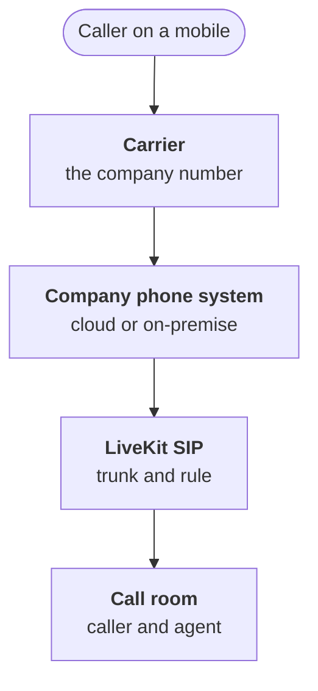

:::tldr
A call reaches the agent over SIP: the carrier or your phone system passes it to LiveKit, a room is created for each call, and the agent joins it. You do not need to change the number: a forwarding rule or a branch of the existing menu points to the agent. Phone audio is narrowband and noisy, so test recognition on phone recordings, not browser ones. Hand over to a human so the advisor gets a summary before picking up, and if nobody answers, the agent returns to the caller and promises a callback. Start the rollout with evenings, weekends and calls nobody answers today.
:::

## How a call reaches the agent



The phone network and internet calls meet in the SIP protocol. A carrier or a cloud phone system can send a call over SIP to a given address. On the other side LiveKit SIP receives it: for every incoming call it creates a room, adds the caller as a participant and, following a dispatch rule, calls in the agent. From then on, for the agent the call is no different from the browser conversation in the previous parts.

Setup comes down to two objects. An inbound trunk describes where to accept calls from: the carrier's numbers and addresses, a username and password. A dispatch rule says which room to put the call in and which agent to call. Usually each call gets its own room with the caller's number in its name.

::news{topic="voice"}

## Without changing the number

Customers know the service's number, it is printed on cards and in maps. There is no need to change it for the agent. There are three ways to connect, from simple to flexible:

- **Conditional forwarding.** The phone system forwards the call to the agent if advisors have not answered in twenty seconds or the call came after hours. The agent works as a safety net.
- **A menu branch.** "To book or check whether your car is ready, stay on the line" leads to the agent, everything else to people.
- **Agent first.** All calls go to the agent first, and it hands over to people what it cannot handle.

The third option has the biggest effect, but do not start with it. More on the rollout order below.

## Phone audio

An agent that worked perfectly in the browser suddenly starts getting plates and car makes wrong on the phone. The cause is audio. Phone lines often carry narrowband audio at eight kilohertz and compress it with codecs designed for intelligibility, not accuracy. Add mobile networks with dropouts, speakerphone in a car and workshop noise.

A few practical conclusions follow:

- **Test recordings from phones only.** The hundred calls we transcribed in part two must be phone calls. A model chosen on browser recordings can lose on the phone.
- **A model trained on telephony.** Some recognition models are trained specifically on narrowband calls, and it shows on the phone.
- **Hints matter more.** On bad audio a dictionary of car makes and service names helps even more.
- **Read numbers back.** The agent repeats the plate and phone number and waits for confirmation. More on that in the next part.

Echo and network latency grow too. On the phone another hundred to hundred and fifty milliseconds is added to the latency budget from part one, one more reason to keep the other links fast.

## The caller's number

SIP passes the caller's number, and it is a valuable hint: it lets you find the customer, their car and their next booking right away. The agent starts the conversation already knowing: "Hello, Andrew! Calling about your Thursday booking?"

But the caller's number is a hint, not identity verification. It can be spoofed, and a husband may call from his wife's phone. So the rule is simple: the agent suggests based on the number, and for actions that touch someone's data it asks for something only the owner knows. The car's plate is enough for repair status and for cancelling a booking. The agent does nothing involving money by voice.

## Handing over to a human

Handing over to a service advisor is not the agent's failure but an important function. A bad handover looks like this: the caller spent three minutes explaining the problem, got transferred, and the advisor asks: "Hello, what can I do for you?" A good handover looks different.

1. **The agent decides to transfer.** The caller asked for a person, the question is outside the agent's scope, or the agent failed to understand an answer twice.
2. **The advisor gets a summary.** The model writes three lines: who is calling, which car, what the customer wants and what has been established. The summary reaches the advisor in the work chat or CRM before they pick up.
3. **The call is transferred.** LiveKit transfers the SIP participant to the advisor's number or the advisors' queue.
4. **If nobody answers.** After thirty seconds the agent returns to the caller: "The advisors are busy right now. I've passed on your question, you'll get a call back within an hour." And it creates a callback task with the same summary.

To the model the transfer tool looks like any other. The description must say when to call it and when not to, otherwise a cautious model starts transferring every other call:

```python
@function_tool
async def transfer_to_advisor(ctx: RunContext, summary: str) -> str:
    """Connect to a service advisor. Call it if the caller asks for a person,
    disputes a price or repair quality, or if you failed to understand twice.
    summary: three lines for the advisor, who is calling and what they want."""
    await notify_advisors(caller=ctx.userdata.phone, summary=summary)
    return await transfer_or_callback(ctx, to=ADVISORS_QUEUE, wait_s=30)
```

"Put me through to a person" must work from the first second of the call, without persuasion or attempts to retain. A caller who was refused a person will remember it longer than any successful call.

## The greeting and recording

The agent's first sentence does two things: says honestly that this is a voice assistant and warns that the call is recorded.

> "Motor car service, voice assistant. This call is recorded. How can I help?"

It takes three seconds and solves several problems at once. The caller does not feel deceived on realizing they are talking to a machine. Recording the call is lawful. And the word "assistant" itself hints that you can ask for a person.

## Where to start the rollout

Putting the agent first on all calls on day one is a risk that is easy to avoid. A sensible order:

1. **Evenings and weekends.** Calls nobody answers today. Any conversation with the agent beats ringing out, and mistakes cost little.
2. **Daytime overflow.** Calls advisors did not pick up within twenty seconds.
3. **A menu branch.** Bookings and repair status through the agent, the rest to people.
4. **Agent first.** When the metrics from the [sixth part](/blog/voice-quality/) have been stable for several weeks.

At each step compare the share of calls closed without a human, the share of transfers and complaints.

## What's next

The agent takes calls and can hand them to a person. In the [fifth part](/blog/voice-tools/) we give it real actions: finding slots in the schedule, booking and rescheduling, telling the repair status, and we teach it to confirm dates, times and plates by voice without mistakes.
