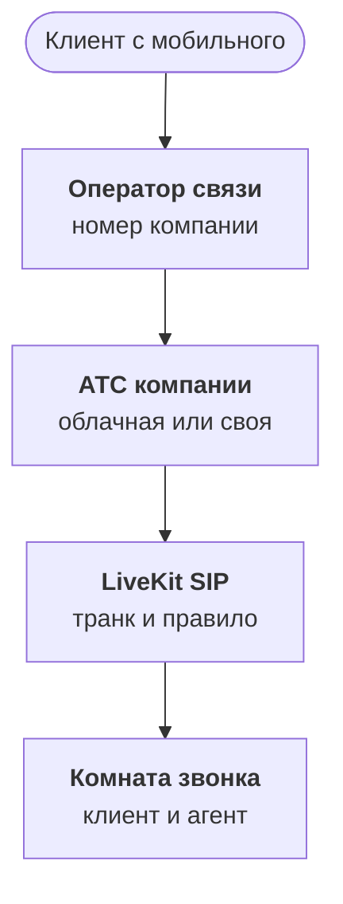

:::tldr
Звонок приходит к агенту по SIP: оператор связи или ваша АТС передаёт его в LiveKit, там для каждого звонка создаётся комната, и в неё заходит агент. Номер менять не нужно: на агента направляется переадресация или ветка существующего меню. Телефонный звук узкополосный и шумный, поэтому распознавание проверяем на записях с телефона, а не из браузера. Перевод на человека делаем так, чтобы мастер получил пересказ разговора до того, как возьмёт трубку, а если он не отвечает, агент возвращается к клиенту и обещает перезвонить. Запуск начинаем с вечера, выходных и звонков, на которые сейчас никто не отвечает.
:::

## Как звонок попадает к агенту



Телефонная сеть и интернет-звонки встречаются в протоколе SIP. Оператор связи или облачная АТС умеют отправить звонок по SIP на заданный адрес. С другой стороны его принимает LiveKit SIP: для каждого входящего звонка он создаёт комнату, добавляет туда клиента как участника и по правилу диспетчеризации зовёт агента. Дальше для агента звонок ничем не отличается от разговора в браузере из прошлых частей.

Настройка сводится к двум объектам. Входящий транк описывает, откуда принимать звонки: номера и адреса оператора, логин и пароль. Правило диспетчеризации говорит, в какую комнату класть звонок и какого агента звать. Обычно каждый звонок получает свою комнату с номером звонящего в имени.

::news{topic="voice"}

## Не меняя номер

Номер автосервиса знают клиенты, он напечатан на визитках и в картах. Менять его ради агента не нужно. Есть три варианта подключения, от простого к гибкому:

- **Переадресация по условию.** АТС переводит звонок на агента, если приёмщики не ответили за двадцать секунд или звонок пришёл в нерабочее время. Агент работает как страховка.
- **Ветка меню.** «Чтобы записаться или узнать о готовности машины, оставайтесь на линии» ведёт к агенту, остальное к людям.
- **Агент первым.** Все звонки сначала попадают к агенту, а он переводит на людей то, с чем не справляется.

Третий вариант даёт наибольший эффект, но начинать с него не стоит. О порядке запуска ниже.

## Телефонный звук

Агент, который отлично работал в браузере, по телефону вдруг начинает ошибаться в номерах и марках. Причина в звуке. Телефонная связь часто передаёт звук узкой полосой, восемь килогерц, и сжимает его кодеками, рассчитанными на понятность речи, а не на точность. Добавьте мобильную связь с провалами, громкую связь в машине и шум мастерской.

Отсюда несколько практических выводов:

- **Тестовые записи только с телефона.** Сотня звонков, которые мы расшифровали во второй части, должна быть именно телефонной. Модель, выбранная по записям из браузера, может проиграть на телефоне.
- **Модель, обученная на телефонии.** Некоторые модели распознавания обучены именно на узкополосных звонках, и на телефоне это заметно.
- **Подсказки важнее.** На плохом звуке словарь марок машин и названий услуг помогает ещё сильнее.
- **Переспрашивать цифры.** Номер машины и телефон агент повторяет и ждёт подтверждения. Об этом подробнее в следующей части.

Эхо и задержка сети тоже растут. В телефоне к бюджету задержки из первой части добавляется сотня-полторы миллисекунд, и это ещё одна причина держать остальные звенья быстрыми.

## Номер звонящего

SIP передаёт номер звонящего, и это ценная подсказка: по нему можно сразу найти клиента, его машину и ближайшую запись. Агент начинает разговор уже со знанием: «Здравствуйте, Андрей! Звоните по записи на четверг?»

Но номер звонящего это подсказка, а не проверка личности. Его можно подделать, а с телефона жены может звонить муж. Поэтому правило простое: по номеру агент предлагает, а для действий, которые затрагивают чужие данные, переспрашивает то, что знает только владелец. Для статуса ремонта достаточно госномера машины, для отмены записи тоже. Ничего денежного голосом агент не делает.

## Перевод на человека

Перевод на мастера-приёмщика это не провал агента, а его важная функция. Плохой перевод выглядит так: клиент три минуты объяснял проблему, его перевели, и мастер спрашивает: «Слушаю, что у вас?» Хороший перевод выглядит иначе.

1. **Агент решает перевести.** Клиент попросил человека, вопрос вне компетенции агента или агент дважды не понял ответ.
2. **Мастер получает пересказ.** Модель пишет три строки: кто звонит, какая машина, чего хочет клиент и что уже выяснено. Пересказ приходит мастеру в рабочий чат или в CRM до того, как он возьмёт трубку.
3. **Звонок переводится.** LiveKit переводит SIP-участника на номер мастера или очередь приёмщиков.
4. **Если никто не ответил.** Через тридцать секунд агент возвращается к клиенту: «Мастера сейчас заняты. Я передал ваш вопрос, вам перезвонят в течение часа». И создаёт задачу на перезвон с тем же пересказом.

Инструмент перевода выглядит для модели так же, как любой другой. В описании важно написать, когда его вызывать, а когда нет, иначе осторожная модель начнёт переводить каждый второй звонок:

```python
@function_tool
async def transfer_to_advisor(ctx: RunContext, summary: str) -> str:
    """Соединить с мастером-приёмщиком. Вызывай, если клиент просит человека,
    спорит о цене или качестве ремонта, или если ты дважды не понял ответ.
    summary: три строки для мастера, кто звонит и чего хочет."""
    await notify_advisors(caller=ctx.userdata.phone, summary=summary)
    return await transfer_or_callback(ctx, to=ADVISORS_QUEUE, wait_s=30)
```

Фраза «Соедините с человеком» должна работать с первой секунды разговора, без уговоров и попыток удержать. Клиент, которого отказались соединить, запомнит это дольше, чем любой удачный звонок.

## Приветствие и запись

Первая фраза агента делает две вещи: честно говорит, что это голосовой помощник, и предупреждает о записи разговора.

> «Автосервис „Мотор", голосовой помощник. Разговор записывается. Чем могу помочь?»

Это занимает три секунды и снимает сразу несколько проблем. Клиент не чувствует себя обманутым, когда понимает, что говорит с машиной. Запись разговора законна. А слово «помощник» само подсказывает, что можно попросить человека.

## С чего начинать запуск

Агент первым на всех звонках в первый же день это риск, которого легко избежать. Разумный порядок:

1. **Вечер и выходные.** Звонки, на которые сейчас не отвечает никто. Любой разговор с агентом лучше, чем гудки, а ошибки стоят мало.
2. **Перегрузка днём.** Звонки, которые приёмщики не взяли за двадцать секунд.
3. **Ветка меню.** Запись и статус ремонта через агента, остальное людям.
4. **Агент первым.** Когда метрики из [шестой части](/blog/ru/voice-quality/) стабильны несколько недель.

На каждом шаге сравниваем долю звонков, закрытых без человека, долю переводов и жалобы.

## Что дальше

Агент принимает звонки и умеет передать их человеку. В [пятой части](/blog/ru/voice-tools/) дадим ему настоящие действия: искать окна в расписании, записывать и переносить, рассказывать о статусе ремонта, и научим подтверждать голосом даты, время и номера так, чтобы ошибок не было.
