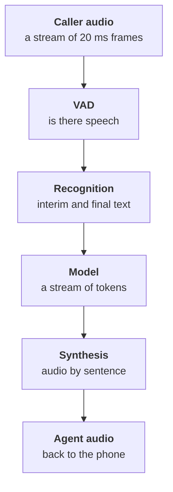

:::tldr
The cascade is three streaming models and a framework that glues them together. Pick recognition not by leaderboards but by errors on a hundred of your own phone recordings: names, car makes, plates and numbers matter most. The language model must produce first tokens quickly, so we take Claude Haiku 5.5, a short cached system prompt and rules for spoken language: short sentences, no lists or markup. Synthesis must start speaking within about a hundred milliseconds and read dates and numbers correctly. Everything streams: synthesis speaks the first sentence while the model writes the second. LiveKit Agents takes care of the glue, and we measure every link.
:::

## The whole pipeline



Audio arrives in twenty-millisecond frames. A voice activity detector (VAD) marks where the person speaks and where there is silence or noise. Recognition receives the speech as a stream and returns text twice: interim text while the person speaks and final text when the sentence ends. The model gets the final text along with the history and starts replying with a stream of tokens. Synthesis takes the reply sentence by sentence and returns audio right away.

No link waits for the previous one to finish entirely. That is why the reply can be heard after a second even though the model needs three to generate the full answer.

::news{topic="voice"}

## Recognition: measure on your own recordings

Speech recognition (ASR, or STT) makes different mistakes on different data. A model that leads on clean English recordings can stumble on phone audio in another language with workshop noise behind it. So the choice starts not with leaderboards but with your own recordings.

Take a hundred real calls, transcribe them by hand and run them through the candidates. Look at three things:

- **Overall word error rate (WER).** Useful for comparison, but not the main thing.
- **Errors in important words.** Names, car makes and models, license plates, phone numbers, dates and times. One mistake in a plate costs more than ten mistakes in filler words.
- **Latency of the final text.** How many milliseconds pass from the end of the sentence to the final result.

As of mid-2026 the candidates fall into two groups. Open streaming models you can run yourself, for example T-one from T-Bank, trained specifically on Russian telephony, and fresh open models from Mistral and NVIDIA. And cloud services like Deepgram or Yandex SpeechKit, where you set up nothing. Whisper is great for transcribing recordings after the fact, but it is not designed for streaming and is better left out of live conversation.

Almost every model accepts hints: a list of words that often appear in your calls. Car makes, service names, station addresses. It is a cheap way to cut errors in important words noticeably.

## The model: fast first tokens

In voice a model is judged differently than in chat. Intelligence matters, but so does time to first token: the user hears the reply only when the model starts writing. Claude Haiku 5.5 strikes a good balance: it handles tool calls and clarifications, and first tokens arrive within a couple of hundred milliseconds.

What else helps:

- **A short cached system prompt.** Rules and the service's reference sheet sit at the start of the prompt and are cached, so each turn does not recompute them. Caching is covered in detail in the [cost part](/blog/agent-cost/) of the agent series.
- **No thinking out loud.** Extended thinking is almost always unnecessary in voice: it adds seconds before the first sound.
- **Rules for spoken language.** The model writes for the ear, not the eye.

The spoken language rules look like this:

```text
You are the voice assistant of the "Motor" car service. You are on the phone.
- Answer in one or two short sentences. One question at a time.
- No lists, markup, emoji or links.
- Say times and dates in words: "on Thursday at ten thirty".
- If unsure, ask again. If you cannot help, offer to connect an advisor.
```

A list of six booking options is convenient on screen and unbearable by voice. So the agent offers the two nearest slots and asks whether one works.

## Synthesis: fast, and numbers read right

From speech synthesis (TTS) we need three things: the first sound within about a hundred milliseconds, a natural voice and correct reading of numbers, dates, addresses and abbreviations.

In 2026 open models caught up with cloud ones on quality. Qwen3-TTS returns the first chunk of audio in roughly a hundred milliseconds, speaks many languages, can clone a voice from a few seconds of recording, and is released under Apache 2.0. The same synthesis voices the videos for the articles on this blog. Popular cloud options are ElevenLabs and Yandex SpeechKit.

The most common problem is not the voice but text normalization. Synthesis may read "10:30" as "ten colon thirty", a service code like "TO-2" as a word, and a license plate as a jumble of sounds. So a small layer sits between the model and synthesis that turns numbers, times and plates into words. A rule in the prompt does part of the job, and this layer covers the rest.

Pick your voice once and keep it: customers get used to a company's voice the way they get used to a logo.

## Glue on LiveKit Agents

You can wire everything by hand, but then you handle streams, buffers, interruptions and cancelling half-spoken replies yourself. LiveKit Agents does this out of the box. The voice world lives in Python, so the pipeline is in Python too, and the agent's tools call services written in anything over HTTP.

```python
session = AgentSession(
    vad=silero.VAD.load(),                # hears where speech is
    stt=stt,                              # streaming recognition
    llm=anthropic.LLM(model="claude-haiku-5-5", temperature=0.3),
    tts=tts,                              # streaming synthesis
    turn_detection=MultilingualModel(),   # did the person finish the thought
)
await session.start(room=ctx.room, agent=Receptionist())
```

`stt` and `tts` here come from the plugin of the service you chose or from your own adapter to a model on your GPU. The `Receptionist` agent holds the system prompt and the tools, covered in detail in part five. The end-of-turn detector deserves its own discussion and is the topic of the next part.

Testing is easy in the browser: LiveKit provides a playground where you talk to the agent through your laptop microphone without any telephony.

## Measure every link

A pipeline that "works fast" needs to be measured. LiveKit Agents reports metrics for every turn: when speech ended, when the final text arrived, when the first model token arrived and when the first sound played. We write them to the log together with the text of the turn.

After a dozen test conversations you can already see where time goes. A typical first build: recognition and synthesis fit the budget, while the model sometimes thinks for a second and a half. The cause is almost always a long uncached prompt or the model starting with a tool call that is itself slow. We deal with tools in part five, and shorten and cache the prompt right away.

## What's next

The pipeline hears and speaks, but so far it talks like a walkie-talkie: waits for silence and answers. In the [third part](/blog/voice-turns/) we teach it live dialogue: telling a finished thought from a mere pause, going quiet when interrupted, and not staying silent while it looks up data.
