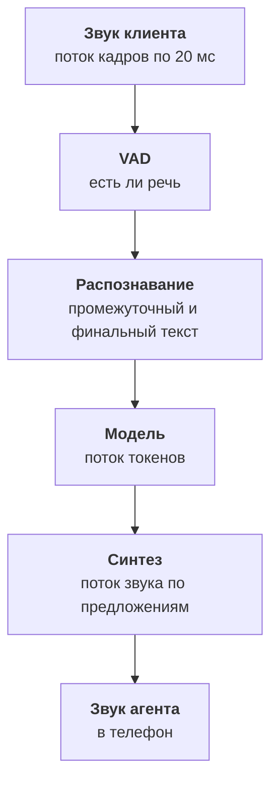

:::tldr
Каскад это три потоковые модели и фреймворк, который их склеивает. Распознавание выбираем не по лидербордам, а по ошибкам на сотне своих телефонных записей: важны имена, марки машин, номера и цифры. Языковая модель должна быстро выдавать первые токены, поэтому берём Claude Haiku 5.5, короткий системный промпт с кэшем и правила устной речи: короткие фразы, без списков и разметки. Синтез должен начинать говорить через сотню миллисекунд и правильно читать даты и числа. Всё работает потоково: синтез озвучивает первое предложение, пока модель пишет второе. LiveKit Agents берёт склейку на себя, а мы меряем каждое звено.
:::

## Конвейер целиком



Звук приходит кадрами по двадцать миллисекунд. Детектор речи (VAD) отмечает, где человек говорит, а где тишина и шум. Распознавание получает речь потоком и выдаёт текст дважды: промежуточный, пока человек говорит, и финальный, когда фраза закончилась. Модель получает финальный текст вместе с историей и начинает отвечать потоком токенов. Синтез забирает ответ по предложениям и сразу отдаёт звук.

Ни одно звено не ждёт, пока предыдущее закончит целиком. Именно поэтому ответ может прозвучать через секунду, хотя на полную генерацию ответа модели нужно три.

::news{topic="voice"}

## Распознавание: мерить на своих записях

Распознавание речи (ASR, или STT) ошибается по-разному на разных данных. Модель, которая лидирует на чистых англоязычных записях, может путаться на русском телефонном звуке с шумом мастерской. Поэтому выбор начинается не с таблиц лидеров, а со своих записей.

Берём сотню реальных звонков, расшифровываем их вручную и прогоняем через кандидатов. Смотрим три вещи:

- **Общая доля ошибок в словах (WER).** Полезна для сравнения, но не главная.
- **Ошибки в важных словах.** Имена, марки и модели машин, госномера, телефоны, даты и время. Одна ошибка в номере стоит больше десяти ошибок в словах-паразитах.
- **Задержка финального текста.** Сколько миллисекунд проходит от конца фразы до финального результата.

Кандидаты на середину 2026 года делятся на две группы. Открытые потоковые модели, которые можно запустить у себя, например T-one от Т-Банка, обученная как раз на русской телефонии, и свежие открытые модели от Mistral и NVIDIA. И облачные сервисы вроде Yandex SpeechKit и Deepgram, где ничего не нужно поднимать. Whisper хорош для расшифровки записей задним числом, но потоковым он не задуман, и для живого разговора его лучше не брать.

Почти все модели умеют принимать подсказки: список слов, которые часто встречаются в ваших звонках. Марки машин, названия услуг, адреса сервисов. Это дешёвый способ заметно снизить ошибки в важных словах.

## Модель: быстрые первые токены

В голосе модель оценивается иначе, чем в чате. Важен не только ум, но и время до первого токена: пользователь слышит ответ, только когда модель начала писать. Claude Haiku 5.5 даёт хороший баланс: справляется с вызовом инструментов и уточнениями, а первые токены приходят за пару сотен миллисекунд.

Что ещё помогает:

- **Короткий системный промпт с кэшем.** Правила и справочник сервиса лежат в начале промпта и кэшируются, тогда каждый ход не пересчитывает их заново. Подробно про кэш в [части про стоимость](/blog/ru/agent-cost/) цикла про агента.
- **Без размышлений вслух.** Расширенное мышление в голосе почти всегда лишнее: оно добавляет секунды до первого звука.
- **Правила устной речи.** Модель пишет для уха, а не для глаза.

Правила устной речи выглядят так:

```text
Ты голосовой помощник автосервиса «Мотор». Говоришь по телефону.
- Отвечай одной-двумя короткими фразами. Один вопрос за раз.
- Никаких списков, разметки, эмодзи и ссылок.
- Время и даты говори словами: «в четверг в десять тридцать».
- Если не уверен, переспроси. Если не можешь помочь, предложи соединить с мастером.
```

Список из шести вариантов записи на экране удобен, голосом он невыносим. Поэтому агент предлагает два ближайших окна и спрашивает, подходит ли.

## Синтез: быстро и правильно читать числа

От синтеза речи (TTS) нужны три вещи: первый звук через сотню миллисекунд, естественный голос и правильное чтение чисел, дат, адресов и сокращений.

Открытые модели в 2026 году догнали облачные по качеству. Qwen3-TTS выдаёт первый кусок звука примерно через сто миллисекунд, говорит по-русски и умеет клонировать голос по нескольким секундам записи, а распространяется под Apache 2.0. Этим же синтезом озвучены видео к статьям этого блога. Из облачных популярны ElevenLabs и Yandex SpeechKit.

Самая частая проблема не голос, а нормализация текста. «10:30» синтез может прочитать как «десять двоеточие тридцать», «ТО-2» как «то два», а госномер как непонятный набор звуков. Поэтому между моделью и синтезом стоит небольшой слой, который переводит числа, время и номера в слова. Часть работы делает правило в промпте, остальное страхует этот слой.

Свой голос стоит выбрать один раз и закрепить: клиенты привыкают к голосу компании так же, как к логотипу.

## Склейка на LiveKit Agents

Связать всё вручную можно, но придётся самому решать потоки, буферы, перебивания и отмену недоговорённых ответов. LiveKit Agents делает это из коробки. Голосовой мир живёт на Python, поэтому конвейер тоже на Python, а инструменты агента ходят по HTTP в сервисы, написанные на чём угодно.

```python
session = AgentSession(
    vad=silero.VAD.load(),                # слышит, где речь
    stt=stt,                              # потоковое распознавание
    llm=anthropic.LLM(model="claude-haiku-5-5", temperature=0.3),
    tts=tts,                              # потоковый синтез
    turn_detection=MultilingualModel(),   # закончил ли человек мысль
)
await session.start(room=ctx.room, agent=Receptionist())
```

`stt` и `tts` здесь подставляются плагином нужного сервиса или своим адаптером к модели на своей видеокарте. Агент `Receptionist` содержит системный промпт и инструменты, о них подробно в пятой части. Детектор конца реплики заслуживает отдельного разговора, это тема следующей части.

Тестировать удобно в браузере: LiveKit даёт игровую площадку, где можно поговорить с агентом через микрофон ноутбука, не подключая телефонию.

## Меряем каждое звено

Конвейер, который «работает быстро», нужно измерить. LiveKit Agents отдаёт метрики по каждому ходу: когда закончилась речь, когда пришёл финальный текст, когда пришёл первый токен модели и когда прозвучал первый звук. Мы пишем их в журнал вместе с текстом реплики.

После десятка тестовых разговоров уже видно, где теряется время. Типичная картина первой сборки: распознавание и синтез укладываются в бюджет, а модель иногда думает полторы секунды. Почти всегда причина в длинном промпте без кэша или в том, что модель начинает с вызова инструмента, который сам отвечает медленно. С инструментами разберёмся в пятой части, а промпт сокращаем и кэшируем сразу.

## Что дальше

Конвейер слышит и говорит, но пока разговаривает как рация: ждёт тишины и отвечает. В [третьей части](/blog/ru/voice-turns/) научим его вести живой диалог: понимать, что человек закончил мысль, а не просто сделал паузу, замолкать, когда его перебивают, и не молчать, пока ищет данные.
