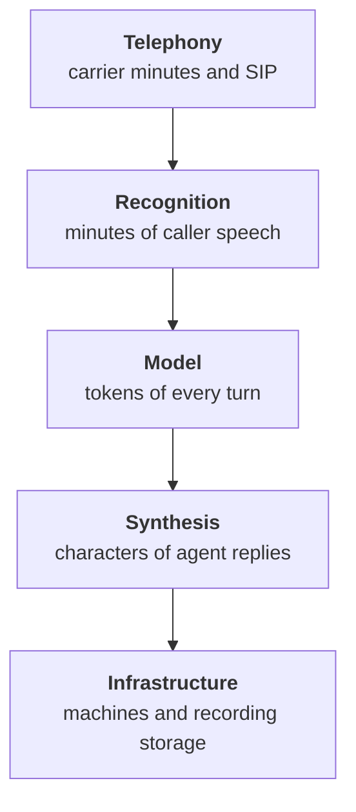

:::tldr
Even four hundred calls a day give only a few simultaneous conversations at peak, so the agent needs a couple of small machines and scales by adding worker processes. The cost of a minute is made of telephony, recognition, the model and synthesis; in a cloud cascade synthesis and telephony are usually the most expensive, and a model with prompt caching costs less. Your own speech models on one GPU pay off when minutes are plentiful. Recordings and transcripts are personal data: a purpose, a retention period, masked numbers, access by list. Monitor the share of failed calls, latency and provider errors, and on any failure the call goes to people, not into silence.
:::

## How many calls at once

Four hundred calls a day sounds impressive, but capacity planning cares about peak simultaneous conversations, not the total. A rough estimate for our service:

- the busiest hour brings about fifteen percent of daily calls, that is sixty;
- an average conversation with the agent lasts about two and a half minutes;
- so in the peak hour two or three conversations run at once on average, and up to eight or ten in short bursts.

One LiveKit Agents worker process serves several calls, and only light models run on its CPU: the voice activity detector, the end-of-turn model and noise suppression. Recognition, synthesis and the language model run in the cloud or on a separate GPU. So two small machines are enough for a chain of six stations: the second is there not for capacity but so calls are not lost while the first is updated or down.

Scaling is simple: more calls, more worker processes. The LiveKit server hands calls to free processes itself.

::news{topic="voice"}

## What the cost of a minute is made of

Each link is billed differently, and it pays to count them separately:

- **Telephony.** The carrier's per-minute rate for inbound calls and the SIP trunk. It does not depend on who answers, the agent or a person.
- **Recognition.** Per minute, but only for the caller's audio. In the cloud it is one of the noticeable lines.
- **Model.** Tokens for every turn: the system prompt with the reference sheet, the history and the reply. With prompt caching the constant part is almost free, and a fast Haiku-class model is inexpensive. It is usually not the biggest line.
- **Synthesis.** In the cloud it is billed by characters or minutes of spoken text and often turns out to be the most expensive part. Short agent turns save both the caller's time and money.
- **Infrastructure.** Machines for worker processes, a LiveKit server or its cloud version, recording storage.

Compare the total not with zero but with two numbers: the cost of an advisor's minute including salary and taxes, and the cost of a lost call nobody answered. For a car service a missed evening call is a service booking that never happened, and that number alone usually justifies the agent.

## Own speech models or cloud

At the start cloud recognition and synthesis are more convenient: nothing to run, good quality, you pay for actual minutes. Your own models pay off when minutes are plentiful, and also when audio must not leave your perimeter.

Open models of 2026 make this possible. Streaming recognition and synthesis like Qwen3-TTS run on one mid-range GPU and serve dozens of conversations in parallel. How to rent such a GPU, run a server on it and work out the hourly cost is covered in detail in the [inference series](/blog/inference-media/). The language model is usually best left on the API: Haiku calls tools quickly, and an own model of the same quality and speed would need separate tuning.

The rule is simple: take monthly minutes, multiply by the cloud rate and compare with the monthly GPU rental plus engineering time. While the cloud is cheaper, stay in the cloud.

## Recordings and personal data

The voice, phone number, name, car and plate are personal data, and a call recording especially so. Handle them as carefully as any customer database; the legal requirements depend on the country: GDPR in Europe, 152-FZ in Russia with its requirement to store citizens' data in Russia.

A minimal set of rules:

- **Purpose and notice.** The caller hears at the start that the call is recorded, and the privacy policy says why: service quality and reviewing mistakes.
- **Retention.** Keep audio for, say, thirty days, enough for the weekly review and disputes. Transcripts longer, but with phone numbers and plates masked.
- **Access by list.** Only those running the review listen to recordings. Every listen is logged.
- **Where data is processed.** Recognition, synthesis and the model see the text or audio of the conversation. Know each provider's processing region and the retention terms in the contract. If audio must not leave the country or the perimeter, that is an argument for your own speech models from the section above.

A word on honesty. The agent introduces itself as a voice assistant in its very first sentence. In the European Union, since August 2026 the AI Act explicitly requires telling people they are talking to an AI, and other countries are moving the same way. But even without the law it is right: deception is quickly discovered and damages the company more than any robot.

## Monitoring and alerts

Monitor what the customer will notice, not just CPU load:

| Metric | Alert when |
|---|---|
| Calls ended with an error | above 2% over half an hour |
| Response latency, 95th percentile | above two seconds |
| Speech and model provider errors | any spike |
| Share of transfers to an advisor | jumps sharply |
| Scheduling tool errors | more than a few in a row |

A sharp rise in transfers often shows first a problem that technical metrics miss: recognition broke on some word, the scheduling system answers oddly, or after a prompt change the agent became more cautious.

## Fail toward people

The main production rule: on any failure the caller must reach a person, not silence.

- **The agent did not come up.** If a call has no agent within three seconds, the phone system sends it to the advisors' queue, as before the agent.
- **A provider broke.** A backup provider is configured for recognition and synthesis, and LiveKit Agents can switch between them. If that does not help either, the agent transfers the call to people.
- **A tool does not answer.** The agent apologizes, promises a callback and creates a task, as in part five.
- **No people in the evening.** The agent takes a message and promises a call back in the morning. Still better than ringing out.

## Versions and rollout

The prompt, model, recognition, synthesis and turn-taking parameters make up the agent's version. Its number is written to the log of every call. A new version passes the simulation from the previous part, then gets ten percent of calls, and only if the metrics are no worse, all calls. A rollback is changing the version number, not an urgent prompt edit on a Friday evening.

## Before launch

1. The agent introduces itself and warns about recording.
2. "Put me through to a person" works from the first second.
3. Before every action the agent reads back the key details and waits for "yes".
4. The simulated call set passes in full.
5. 95th percentile latency fits within two seconds on phone calls.
6. When the agent is down, calls go to people, checked by hand.
7. Recording retention and access are configured.
8. Alerts arrive in the work chat.
9. The weekly review is on the calendar.

## Series summary

1. A voice agent pays off on frequent repetitive calls, and a second of latency decides everything.
2. The cascade of recognition, model and synthesis streams, and we measure every link.
3. An end-of-turn model and proper interruption handling make the conversation feel alive.
4. Calls arrive over SIP without changing the number, and handover to a person comes with a summary.
5. Tools answer briefly and hold slots, and the agent confirms everything by voice.
6. Simulation, outcome metrics and a weekly review keep quality up.
7. In production the agent is cheap, protects data and on any failure hands the call to people.

The agent from this series does not replace service advisors. It takes evening calls, routine bookings and "is my car ready" questions, and leaves people the conversations that need experience and responsibility. That is a good division of labor.
