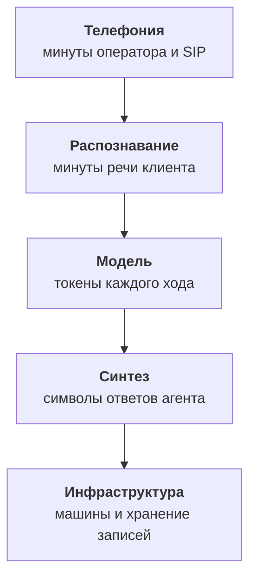

:::tldr
Даже четыреста звонков в день дают в пик всего несколько разговоров одновременно, так что агенту хватает пары небольших машин, а масштабируется он добавлением рабочих процессов. Цена минуты складывается из телефонии, распознавания, модели и синтеза; в облачном каскаде дороже всего обычно синтез и телефония, а модель с кэшем промпта стоит меньше. Свои модели речи на одной видеокарте выгодны, когда минут много. Записи и расшифровки это персональные данные: цель, срок хранения, маскирование номеров, доступ по списку. Мониторим долю неудачных звонков, задержку и ошибки провайдеров, а при любом сбое звонок уходит людям, а не в тишину.
:::

## Сколько звонков одновременно

Четыреста звонков в день звучит внушительно, но для расчёта мощности важна не сумма, а пик одновременных разговоров. Прикинем для нашего сервиса:

- в самый загруженный час приходит около пятнадцати процентов дневных звонков, то есть шестьдесят;
- средний разговор с агентом длится около двух с половиной минут;
- значит, в пиковый час в среднем идёт два-три разговора одновременно, а в короткие всплески до восьми-десяти.

Один рабочий процесс LiveKit Agents обслуживает несколько звонков, а на процессоре в нём работают только лёгкие модели: детектор речи, модель конца реплики и шумоподавление. Распознавание, синтез и языковая модель работают в облаке или на отдельной видеокарте. Поэтому агенту для сети из шести сервисов хватает двух небольших машин: вторая нужна не для мощности, а чтобы звонки не терялись при обновлении или падении первой.

Масштабируется это просто: больше звонков, больше рабочих процессов. Сервер LiveKit сам раздаёт звонки свободным процессам.

::news{topic="voice"}

## Из чего складывается цена минуты

Каждое звено тарифицируется по-своему, и их полезно считать отдельно:

- **Телефония.** Поминутный тариф оператора на входящие и SIP-транк. Не зависит от того, кто отвечает, агент или человек.
- **Распознавание.** Поминутно, но только за звук клиента. В облаке это одна из заметных строк.
- **Модель.** Токены за каждый ход: системный промпт со справочником, история и ответ. С кэшем промпта постоянная часть почти бесплатна, а быстрая модель уровня Haiku стоит недорого. Обычно это не самая большая строка.
- **Синтез.** В облаке считается по символам или минутам озвученного текста и часто оказывается самой дорогой частью. Короткие реплики агента экономят и время клиента, и деньги.
- **Инфраструктура.** Машины для рабочих процессов, сервер LiveKit или его облачная версия, хранение записей.

Сравнивать итог нужно не с нулём, а с двумя цифрами: стоимостью минуты приёмщика с учётом зарплаты и налогов и ценой потерянного звонка, на который никто не ответил. Для автосервиса пропущенный вечерний звонок это несостоявшаяся запись на ТО, и обычно уже эта цифра оправдывает агента.

## Свои модели речи или облако

На старте облачные распознавание и синтез удобнее: ничего не нужно поднимать, качество хорошее, платите за фактические минуты. Свои модели становятся выгодны, когда минут много, а также когда звук не должен покидать ваш контур.

Открытые модели 2026 года это позволяют. Потоковое распознавание и синтез вроде Qwen3-TTS работают на одной видеокарте среднего класса и обслуживают десятки разговоров параллельно. Как арендовать такую видеокарту, поднять на ней сервер и посчитать цену часа, подробно разобрано в [цикле про инференс](/blog/ru/inference-media/). Языковую модель обычно разумно оставить по API: Haiku быстро вызывает инструменты, а своя модель того же качества и скорости потребует отдельной настройки.

Правило простое: считайте месячные минуты, умножайте на облачный тариф и сравнивайте с месячной арендой видеокарты плюс временем инженера. Пока облако дешевле, оставайтесь в облаке.

## Записи и персональные данные

Голос, номер телефона, имя, машина и госномер это персональные данные, а запись разговора особенно. Обращаться с ними нужно так же аккуратно, как с любой клиентской базой, а требования закона зависят от страны: в России это 152-ФЗ с требованием хранить данные граждан в России, в Европе GDPR.

Минимальный набор правил:

- **Цель и предупреждение.** Клиент слышит в начале звонка, что разговор записывается, а в политике обработки данных написано, зачем: качество обслуживания и разбор ошибок.
- **Срок хранения.** Звук хранится, например, тридцать дней, этого хватает для еженедельного разбора и споров. Расшифровки дольше, но с замаскированными номерами телефонов и госномерами.
- **Доступ по списку.** Записи слушают только те, кто проводит разбор. Каждое прослушивание пишется в журнал.
- **Где обрабатываются данные.** Распознавание, синтез и модель видят текст или звук разговора. Нужно знать регион обработки у каждого провайдера и условия хранения в договоре. Если звук не должен покидать страну или контур, это довод за свои модели речи из раздела выше.

Отдельно о честности. Агент представляется голосовым помощником в первой же фразе. В Европейском союзе с августа 2026 года AI Act прямо требует сообщать людям, что они разговаривают с ИИ, и остальные страны движутся в ту же сторону. Но и без закона это правильно: обман быстро раскрывается и портит отношение к компании сильнее, чем любой робот.

## Мониторинг и тревоги

Мониторим то, что увидит клиент, а не только загрузку процессора:

| Метрика | Тревога, когда |
|---|---|
| Звонки, завершённые ошибкой | больше 2% за полчаса |
| Задержка ответа, 95-й процентиль | выше двух секунд |
| Ошибки провайдеров речи и модели | любой всплеск |
| Доля переводов на мастера | резко выросла |
| Ошибки инструментов расписания | больше нескольких подряд |

Резкий рост переводов часто первым показывает проблему, которую не видят технические метрики: сломалось распознавание какого-то слова, система расписания отвечает странно или после изменения промпта агент стал осторожнее.

## Падать в сторону людей

Главное правило прода: при любом сбое клиент должен дозвониться до человека, а не попасть в тишину.

- **Агент не поднялся.** Если звонок не получил агента за три секунды, АТС отправляет его в очередь приёмщиков, как было до агента.
- **Сломался провайдер.** Для распознавания и синтеза настроен запасной провайдер, LiveKit Agents умеет переключаться между ними. Если не помог и он, агент переводит звонок людям.
- **Инструмент не отвечает.** Агент извиняется, обещает перезвонить и создаёт задачу, как в пятой части.
- **Вечером людей нет.** Агент принимает сообщение и обещает перезвонить утром. Это всё равно лучше гудков.

## Версии и выкатка

Промпт, модель, распознавание, синтез и параметры очерёдности это версия агента. Её номер пишется в журнал каждого звонка. Новая версия проходит симуляцию из прошлой части, потом получает десять процентов звонков, и только если метрики не хуже, все звонки. Откат это смена номера версии, а не срочная правка промпта в пятницу вечером.

## Перед запуском

1. Агент представляется и предупреждает о записи.
2. «Соедините с человеком» работает с первой секунды.
3. Перед каждым действием агент проговаривает главное и ждёт «да».
4. Набор симулированных звонков проходит целиком.
5. Задержка в 95-м процентиле укладывается в две секунды на телефонных звонках.
6. При падении агента звонок уходит людям, проверено руками.
7. Сроки хранения записей и доступ к ним настроены.
8. Тревоги приходят в рабочий чат.
9. Еженедельный разбор стоит в календаре.

## Итоги цикла

1. Голосовой агент окупается на частых однотипных звонках, а секунда задержки решает всё.
2. Каскад из распознавания, модели и синтеза работает потоково, и каждое звено мы меряем.
3. Модель конца реплики и правильная обработка перебиваний делают разговор живым.
4. Звонки приходят по SIP без смены номера, а перевод на человека идёт с пересказом.
5. Инструменты отвечают коротко, придерживают окна, а агент подтверждает всё голосом.
6. Симуляция, метрики исхода и еженедельный разбор держат качество.
7. В проде агент дёшев, бережёт данные и при любом сбое отдаёт звонок людям.

Агент из этого цикла не заменяет приёмщиков. Он берёт на себя вечерние звонки, однотипные записи и вопросы «готова ли машина», а людям оставляет разговоры, где нужны опыт и ответственность. Это и есть хорошее разделение труда.
