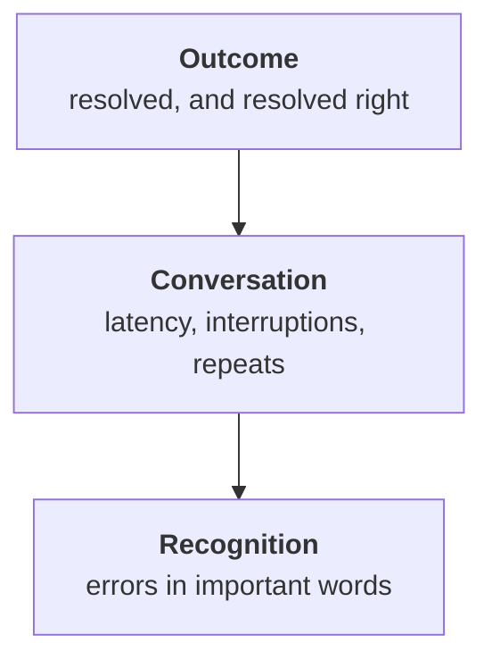

:::tldr
A voice agent's quality has three layers: the call outcome (was the question resolved without a human, and resolved correctly), the conversation itself (latency, interruptions, repeats) and recognition. The key metric, correct bookings, is checked automatically: compare what the agent put into the schedule with what was agreed in the conversation. Before rollout every change to the prompt, model or recognition runs through fifty simulated calls: a model plays a caller with a temperament and a goal, and the result is checked against a test schedule and by a judge model. After rollout, every week we listen to twenty recordings, label the causes of mistakes and turn new cases into new scenarios.
:::

## What "works well" means

The agent from the previous parts takes calls. A week later the service director asks: "So, does it work?" "Seems fine, no complaints" is a bad answer: unhappy customers do not complain, they just call the competition. You need numbers, and they fall into three layers.



Look top down. If the outcome is good, the conversation and recognition matter only as ways to make it even better. If the outcome is bad, the cause is almost always in one of the lower layers.

::news{topic="voice"}

## Outcome metrics

| Metric | How we count | What to watch |
|---|---|---|
| Closed without a human | call ended with a booking, reschedule, answer | grows over time |
| Correct actions | booking matches what was agreed | close to 100% |
| Transfers to an advisor | share and reasons | does not grow without cause |
| Drops | caller hung up mid-conversation | falls |
| Repeat call | same number calls again within a day | falls |

The second row matters most. An agent that closes many calls but sometimes books the wrong day is worse than an agent that transfers to a person more often. It can be checked automatically: after each call a model reads the transcript and extracts what was agreed, and a script compares it with what actually appeared in the schedule. Any mismatch goes straight to review.

A repeat call within a day is also a good signal. If the customer called back, the first conversation most likely did not solve their problem, even if the agent logged it as a success.

## Conversation metrics

We have been writing these numbers to the log since part two; it only remains to collect them:

- **Response latency**, median and 95th percentile, per link. The median speaks about a typical conversation, the percentile about the worst moments, which customers remember.
- **Agent talked over the caller.** How often the agent started speaking before the caller finished.
- **"Hello?" and repeats.** The caller asks again or repeats a sentence. It usually means the agent was silent too long or did not understand.
- **Call length** by task type. A booking that takes four minutes is doing something wrong.

## Simulated calls

Testing every change on live customers is expensive and risky. So before rollout the agent talks to simulated callers. A simulated caller is the same kind of language model with a short role:

```text
You are a car service customer. Goal: book a Skoda Octavia for brake pads this week.
Temperament: in a hurry, short answers, you interrupt the agent once.
You remember the plate only by its digits: 482. If offered Saturday, decline.
When the goal is reached or the agent cannot help, say goodbye.
```

The scenario set covers the main tasks and awkward temperaments: an elderly caller who speaks slowly with pauses, a caller who changes their mind mid-booking, dictates the phone number in pieces, demands a person straight away, asks for something the agent must not do. Fifty or sixty scenarios are enough to catch most regressions.

The run has two levels:

1. **Text.** The caller and the agent exchange text, without recognition or synthesis. It is fast and cheap: fifty conversations in a couple of minutes. It catches mistakes in logic, the prompt and tools.
2. **Voice.** The caller's turns are spoken by synthesis with different voices, noise and a phone codec are added, and the audio goes into the agent exactly as on the phone. Slower, but it catches recognition and turn-taking mistakes. Run it before rollout and when changing speech models.

During the run the agent works with a test copy of the schedule that is reset to the same state before each scenario.

## How to check the result

Each scenario is checked in two ways.

**Deterministically.** After the conversation look at the test schedule: did a booking appear, for the right service, station and time, and no extra ones. For the "demands a person" scenario check that a transfer was called rather than an attempt to talk the caller out of it. These checks do not make mistakes and form the foundation.

**With a judge model.** What cannot be checked in the database is graded by another model against a short list: did the agent confirm the date and time before booking, did it speak in short sentences, did it promise anything it cannot do, did it introduce itself. The judge answers "yes" or "no" for each item with a quote from the conversation. The approach is the same as in the [evaluation part](/blog/finetune-eval/) of the fine-tuning series.

The run's result is a table: scenario, passed or not, which checks failed. A change ships only if no previously passing scenario got worse.

## The weekly review

Simulation catches what we thought to check. The rest is in real calls. Once a week someone from the service and an engineer listen to twenty recordings:

- every call with a mismatch between the conversation and the schedule;
- every mid-conversation drop;
- a few calls with the worst latency;
- a few transfers to an advisor;
- the rest at random.

Each mistake gets a cause: recognition, understanding, tool, rules, turn-taking. After a couple of weeks you see where the main problem is. At first it is almost always recognition of car makes and addresses, fixed with a hints dictionary. Then rules, fixed in the prompt. Then rare scenarios.

The main rule of the review: every new kind of mistake becomes a new simulation scenario. So the set grows with the agent, and a mistake fixed once never quietly comes back.

## Feedback from people

Service advisors see the consequences of mistakes before anyone else: a customer came on the wrong day, the summary at transfer was useless. A simple "agent got it wrong" button in the booking card or the work chat gives another stream of cases for review. A short SMS survey after the call, one rating from one to five, is useful as background, but sparse answers are poor for finding specific mistakes.

## What's next

The agent works, and we know how well. In the [last part](/blog/voice-prod/) we take it to production for real: how many calls one machine handles, what the cost of a minute is made of and when your own speech models pay off, what to do with recordings and personal data, and what to monitor to learn about a problem before customers do.
