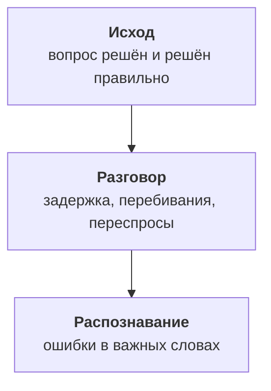

:::tldr
Качество голосового агента складывается из трёх слоёв: исход звонка (закрыт ли вопрос без человека и правильно ли), сам разговор (задержка, перебивания, переспросы) и распознавание. Главную метрику, правильные записи, проверяем автоматически: сверяем, что агент записал в расписание, с тем, о чём договорились в разговоре. До выкатки любое изменение промпта, модели или распознавания прогоняется через полсотни симулированных звонков: модель играет клиента с характером и целью, а итог проверяется по тестовому расписанию и судьёй-моделью. После выкатки каждую неделю слушаем два десятка записей, размечаем причины ошибок и превращаем новые случаи в новые сценарии.
:::

## Что значит «работает хорошо»

Агент из прошлых частей принимает звонки. Через неделю директор сервиса спрашивает: «Ну как, работает?» Ответ «вроде нормально, жалоб нет» плохой: недовольные клиенты не жалуются, они просто звонят соседям. Нужны цифры, и они делятся на три слоя.



Смотреть стоит сверху вниз. Если исход хороший, разговор и распознавание интересны только как способ сделать его ещё лучше. Если исход плохой, причина почти всегда находится в одном из нижних слоёв.

::news{topic="voice"}

## Метрики исхода

| Метрика | Как считаем | На что смотреть |
|---|---|---|
| Закрыто без человека | звонок кончился записью, переносом, ответом | растёт со временем |
| Правильные действия | запись совпала с договорённостью | близко к 100% |
| Переводы на мастера | доля и причины | не растёт без причины |
| Обрывы | клиент положил трубку посреди разговора | падает |
| Повторный звонок | тот же номер звонит снова за сутки | падает |

Самая важная строка вторая. Агент, который закрывает много звонков, но иногда записывает не на тот день, хуже агента, который чаще переводит на человека. Её можно проверять автоматически: после каждого звонка модель читает расшифровку и извлекает, о чём договорились, а скрипт сравнивает это с тем, что реально появилось в расписании. Расхождение сразу попадает в разбор.

Повторный звонок в течение суток тоже хороший сигнал. Если клиент перезвонил, скорее всего, первый разговор не решил его вопрос, даже если агент записал его как успешный.

## Метрики разговора

Эти цифры мы уже пишем в журнал со второй части, осталось их собрать:

- **Задержка ответа**, медиана и 95-й процентиль, по каждому звену. Медиана говорит о типичном разговоре, процентиль о худших моментах, которые клиенты и запоминают.
- **Агент перебил клиента.** Сколько раз агент начал говорить, когда клиент ещё не закончил.
- **«Алло?» и повторы.** Клиент переспрашивает или повторяет фразу. Обычно это значит, что агент слишком долго молчал или не понял.
- **Длина звонка** по типам задач. Запись, которая занимает четыре минуты, что-то делает не так.

## Симулированные звонки

Проверять каждое изменение на живых клиентах дорого и рискованно. Поэтому до выкатки агент разговаривает с симулированными клиентами. Симулированный клиент это та же языковая модель с короткой ролью:

```text
Ты клиент автосервиса. Цель: записать Шкоду Октавию на замену колодок на эту неделю.
Характер: торопишься, отвечаешь коротко, один раз перебиваешь агента.
Номер машины помнишь только цифрами: 482. Если предложат субботу, откажись.
Когда цель достигнута или агент не может помочь, попрощайся.
```

Набор сценариев покрывает основные задачи и неудобные характеры: пожилой клиент, который говорит медленно и с паузами, клиент, который меняет решение посреди записи, диктует телефон кусками, сразу требует человека, спрашивает то, чего агент не должен делать. Пятьдесят-шестьдесят сценариев хватает, чтобы ловить большинство регрессий.

Прогон идёт в два уровня:

1. **Текстовый.** Клиент и агент обмениваются текстом, без распознавания и синтеза. Это быстро и дёшево: полсотни разговоров за пару минут. Ловит ошибки логики, промпта и инструментов.
2. **Голосовой.** Реплики клиента озвучиваются синтезом с разными голосами, к ним добавляется шум и телефонный кодек, и звук идёт в агента так же, как по телефону. Медленнее, но ловит ошибки распознавания и очерёдности. Запускаем перед выкаткой и при смене моделей речи.

Агент в прогоне работает с тестовой копией расписания, которая перед каждым сценарием возвращается в одно и то же состояние.

## Как проверять итог

Каждый сценарий проверяется двумя способами.

**Детерминированно.** После разговора смотрим в тестовое расписание: появилась ли запись, на ту ли услугу, станцию и время, не появилось ли лишних. Для сценария «требует человека» проверяем, что был вызван перевод, а не попытка уговорить. Эти проверки не ошибаются и составляют основу.

**Судьёй-моделью.** То, что нельзя проверить по базе, оценивает другая модель по короткому списку: подтвердил ли агент дату и время перед записью, говорил ли короткими фразами, не обещал ли того, чего не может, представился ли. Судья отвечает «да» или «нет» по каждому пункту с цитатой из разговора. Подход тот же, что в [части про оценку](/blog/ru/finetune-eval/) цикла про дообучение.

Результат прогона это таблица: сценарий, прошёл ли, какие проверки упали. Изменение выкатывается, только если не стало хуже ни одного сценария, который раньше проходил.

## Еженедельный разбор

Симуляция ловит то, что мы догадались проверить. Остальное находится в настоящих звонках. Раз в неделю кто-то из сервиса и инженер слушают двадцать записей:

- все звонки с расхождением между разговором и расписанием;
- все обрывы посреди разговора;
- несколько звонков с худшей задержкой;
- несколько переводов на мастера;
- остальное случайно.

Каждой ошибке ставится причина: распознавание, понимание, инструмент, правила, очерёдность. Через пару недель видно, где основная проблема. В начале это почти всегда распознавание марок и адресов, лечится словарём подсказок. Потом правила, лечится промптом. Потом редкие сценарии.

Главное правило разбора: каждый новый вид ошибки превращается в новый сценарий симуляции. Так набор растёт вместе с агентом, и однажды исправленная ошибка больше не возвращается незаметно.

## Обратная связь от людей

Мастера-приёмщики видят последствия ошибок раньше всех: клиент приехал не в тот день, пересказ при переводе был бесполезным. Простая кнопка «агент ошибся» в карточке записи или в рабочем чате даёт ещё один поток случаев для разбора. Короткий опрос клиента по SMS после звонка, одна оценка от одного до пяти, полезен как общий фон, но редкие ответы плохо подходят для поиска конкретных ошибок.

## Что дальше

Агент работает, и мы знаем, насколько хорошо. В [последней части](/blog/ru/voice-prod/) выведем его в прод по-настоящему: сколько звонков выдержит одна машина, из чего складывается цена минуты и когда выгоднее свои модели речи, что делать с записями и персональными данными, и что мониторить, чтобы узнать о проблеме раньше клиентов.
