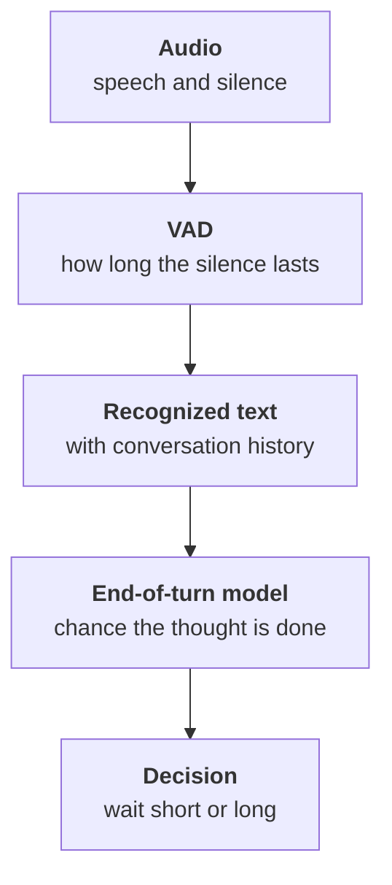

:::tldr
Conversations break not on recognition or synthesis but on turn-taking. If the agent answers after a short silence, it interrupts people who are thinking. If it waits long, it feels sluggish. The fix is two signals at once: the voice activity detector hears silence, and a small end-of-turn model reads the recognized text and estimates whether the thought is finished. When the caller interrupts, the agent goes quiet within a couple of hundred milliseconds and remembers only what it actually said. "Uh-huh" and coughs do not count as interruptions. While a tool looks up data the agent says "one moment, checking", and if the caller goes quiet for long, it gently checks in and ends the call.
:::

## Why silence is not enough

The simplest way to know a person has finished: wait for silence. Half a second with nobody talking means it is the agent's turn. This works in a demo and falls apart on the first real call.

The caller says: "Book me for… (pause, looking at the calendar) …for Thursday, after lunch." Half a second of silence after "for" looks to the agent like the end of the sentence, and it starts answering. The caller keeps talking, the agent talks over them, both stop, and the conversation becomes an awkward dance.

Raise the threshold to a second and a half and the agent stops interrupting, but answers every short "yes" or "no" slowly. Dictation is even worse: people say a phone number with pauses, and any fixed threshold gets it wrong somewhere.

::news{topic="voice"}

## The end-of-turn model

People know the other side has finished not by silence but by meaning and intonation. "Book me for" is clearly unfinished, "book me for Thursday" is finished. You can give this skill to the agent with a small model.



The end-of-turn model takes the last turns of the conversation and returns the probability that the person has finished. LiveKit Agents has such a model built in with multilingual support, and Pipecat has the open Smart Turn, which looks at intonation rather than text. Both run in tens of milliseconds on a CPU.

The decision is then simple. If the model is confident the thought is finished, the agent waits the minimum pause and answers. If not, it waits longer, up to an upper limit. So "yes" gets an answer almost immediately, while "book me for…" gets time to finish.

In LiveKit this is a few session parameters:

```python
session = AgentSession(
    # ...
    turn_detection=MultilingualModel(),
    min_endpointing_delay=0.3,   # pause when the thought is clearly done
    max_endpointing_delay=2.0,   # limit when the model is unsure
)
```

Tune the numbers on recordings of your own calls. For a service where people often dictate plates and phone numbers, keep the upper limit higher.

## When the caller interrupts

People interrupt all the time, and that is normal. The agent starts listing: "There is a slot on Thursday at ten thirty and on Friday…" The caller: "Thursday works." The agent must stop immediately rather than finish its turn.

An interruption is handled in three steps:

1. **Go quiet.** As soon as the detector hears the caller's speech over the agent's voice, synthesis stops. This must take a couple of hundred milliseconds, or the caller raises their voice.
2. **Trim the history.** The model wrote a long reply, but the caller heard only the first half. Only what was actually said goes into the conversation history, otherwise the model will think the caller knows about Friday.
3. **Keep listening.** The caller's new turn is processed as usual.

LiveKit Agents does all three steps itself, but check the second one on your calls: if the model in the log refers to something that was never spoken, the history is trimmed wrong.

## "Uh-huh", coughs and workshop noise

Not every sound over the agent's voice is an interruption. Callers say "uh-huh", "yeah, yeah", "okay" when they are just listening. They cough. A compressor runs nearby or a car engine hums. If the agent stops for every such sound, the conversation becomes choppy.

Three rules help:

- **Minimum duration.** An interruption is speech longer than half a second, not a short sound.
- **Minimum words.** If recognition returned one word from a list of backchannels, the agent keeps talking.
- **False interruption.** If the agent stopped and the caller said nothing after all, after a second the agent resumes where it left off.

Workshop noise is a separate story. The VAD can mistake background voices and tools for speech. Noise suppression at the input helps here, cutting everything but the near voice. Turn it on from day one and test it on recordings from the station, not from a quiet office.

## Do not leave silence

Silence on the phone is scarier than in chat. Two seconds of silence and the caller asks "hello?", five seconds and they hang up.

**While the agent looks up data.** A tool call that searches the schedule for slots can take a second or two. Before slow tools the agent says a short phrase: "One moment, checking the schedule." It can be synthesized in advance so it plays instantly.

**The greeting.** The agent speaks as soon as the call connects, without waiting for the caller to say "hello". The greeting is short and also interruptible: a regular customer often starts talking without listening to the end.

**The caller goes quiet.** If six or seven seconds of silence follow the agent's question, the agent checks in: "Are you still there?" After a second try it says goodbye politely and ends the call, logging that the call dropped.

## How to check

Turn-taking is hard to check by reading transcripts: text does not show that the agent talked over a person. You need two things.

- **Per-turn metrics.** How often the agent started speaking before the caller finished, and how often the caller said "hello?" or repeated themselves. Both numbers should drop after every tuning change.
- **Listening.** Ten recordings a week, heard in full, tell you more about how alive the conversation is than any metric. More on quality checks in the [sixth part](/blog/voice-quality/).

## What's next

The agent talks like a person, but only in the browser so far. In the [fourth part](/blog/voice-phone/) we connect a real phone: a number, a SIP trunk, the quirks of phone audio and handing the call to a service advisor together with a summary of the conversation.
