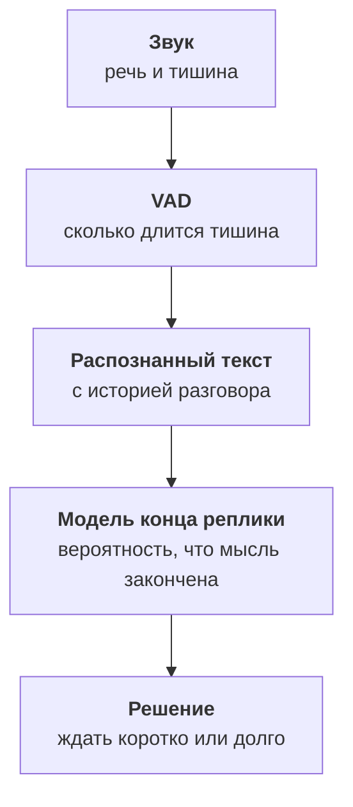

:::tldr
Разговор ломается не на распознавании и не на синтезе, а на очерёдности. Если агент отвечает после короткой тишины, он перебивает людей, которые задумались. Если ждёт долго, кажется тормозом. Решение в двух сигналах сразу: детектор речи слышит тишину, а небольшая модель конца реплики читает распознанный текст и оценивает, закончена ли мысль. Когда клиент перебивает, агент замолкает за пару сотен миллисекунд и запоминает только то, что успел сказать. «Угу» и кашель перебиванием не считаются. Пока инструмент ищет данные, агент говорит «секунду, смотрю», а если клиент замолчал надолго, мягко переспрашивает и завершает звонок.
:::

## Почему тишины мало

Самый простой способ понять, что человек закончил говорить: дождаться тишины. Если полсекунды никто не говорит, значит, очередь агента. Это работает на демо и разваливается на первом настоящем звонке.

Клиент говорит: «Запишите меня на… (пауза, смотрит в календарь) …на четверг, после обеда». Полсекунды тишины после «на» агент воспримет как конец фразы и начнёт отвечать. Клиент продолжит говорить, агент его перебьёт, оба замолчат, и разговор превратится в неловкий танец.

Если увеличить порог до полутора секунд, агент перестанет перебивать, но станет отвечать медленно на каждую короткую реплику вроде «да» или «нет». А ещё хуже с диктовкой: телефон «восемь девятьсот шестнадцать… сто двадцать три…» люди произносят с паузами, и любой фиксированный порог где-то ошибётся.

::news{topic="voice"}

## Модель конца реплики

Люди понимают, что собеседник закончил, не по тишине, а по смыслу и интонации. «Запишите меня на» явно не закончено, «запишите меня на четверг» закончено. Этот навык можно дать агенту маленькой моделью.



Модель конца реплики получает последние реплики разговора и возвращает вероятность того, что человек закончил. В LiveKit Agents такая модель встроена и поддерживает русский, в Pipecat есть открытая Smart Turn, которая смотрит не на текст, а на интонацию. Обе работают за десятки миллисекунд на процессоре.

Дальше решение простое. Если модель уверена, что мысль закончена, агент ждёт минимальную паузу и отвечает. Если не уверена, ждёт дольше, вплоть до верхнего порога. Так «да» получает ответ почти сразу, а «запишите меня на…» получает время договорить.

В LiveKit это несколько параметров сессии:

```python
session = AgentSession(
    # ...
    turn_detection=MultilingualModel(),
    min_endpointing_delay=0.3,   # пауза, если мысль явно закончена
    max_endpointing_delay=2.0,   # предел, если модель сомневается
)
```

Цифры подбираются по записям ваших звонков. Для сервиса, где люди часто диктуют номера машин и телефоны, верхний порог стоит держать повыше.

## Когда клиент перебивает

Люди перебивают постоянно, и это нормально. Агент начал перечислять: «Есть окно в четверг в десять тридцать и в пятницу…» Клиент: «Четверг подходит». Агент должен замолчать немедленно, а не дочитывать свою реплику до конца.

Перебивание обрабатывается в три шага:

1. **Замолчать.** Как только детектор услышал речь клиента поверх голоса агента, синтез останавливается. Это должно занимать пару сотен миллисекунд, иначе клиент повышает голос.
2. **Обрезать историю.** Модель написала длинный ответ, но клиент услышал только первую половину. В историю разговора попадает только сказанное, иначе модель будет думать, что клиент знает про пятницу.
3. **Слушать дальше.** Новая реплика клиента обрабатывается как обычно.

LiveKit Agents делает все три шага сам, но второй стоит проверить на своих звонках: если в журнале модель ссылается на то, что не прозвучало, значит, история обрезается неправильно.

## «Угу», кашель и шум мастерской

Не всякий звук поверх голоса агента означает перебивание. Клиент говорит «угу», «да-да», «так», когда просто слушает. Кашляет. Рядом работает компрессор или гудит машина. Если на каждый такой звук агент замолкает, разговор становится рваным.

Помогают три правила:

- **Минимальная длительность.** Перебиванием считается речь дольше полусекунды, а не короткий звук.
- **Минимум слов.** Если распознавание вернуло одно слово из списка поддакиваний, агент продолжает говорить.
- **Ложное перебивание.** Если агент замолчал, а клиент так ничего и не сказал, через секунду агент продолжает с того места, где остановился.

Шум мастерской отдельная история. Фоновые голоса и инструменты VAD может принять за речь. Здесь помогает шумоподавление на входе, которое отрезает всё, кроме ближнего голоса. Его стоит включить с первого дня и проверить на записях со станции, а не из тихого офиса.

## Не оставлять тишину

Тишина в телефоне пугает сильнее, чем в чате. Две секунды молчания, и клиент спрашивает «алло?», пять секунд, и он кладёт трубку.

**Пока агент ищет данные.** Вызов инструмента, который ищет окна в расписании, может занять секунду или две. Перед медленными инструментами агент говорит короткую фразу: «Секунду, смотрю расписание». Её можно синтезировать заранее, тогда она звучит мгновенно.

**Приветствие.** Агент говорит сразу, как только звонок соединился, не дожидаясь, пока клиент скажет «алло». Приветствие короткое и тоже перебиваемое: постоянный клиент часто начинает говорить, не дослушав.

**Клиент замолчал.** Если после вопроса агента шесть-семь секунд тишины, агент переспрашивает: «Вы ещё на линии?» После второй попытки вежливо прощается и завершает звонок, а в журнал пишет, что звонок оборвался.

## Как проверить

Очерёдность плохо проверяется глазами по расшифровкам: в тексте не видно, что агент перебил человека. Нужны две вещи.

- **Метрики по ходам.** Сколько раз агент начал говорить, когда клиент ещё не закончил, и сколько раз клиент сказал «алло?» или повторил фразу. Оба числа должны падать после каждой настройки.
- **Прослушивание.** Десять записей в неделю, прослушанных целиком, говорят о живости разговора больше любых метрик. Подробнее о проверке качества в [шестой части](/blog/ru/voice-quality/).

## Что дальше

Агент разговаривает по-человечески, но пока только в браузере. В [четвёртой части](/blog/ru/voice-phone/) подключим настоящий телефон: номер, SIP-транк, особенности телефонного звука и перевод звонка на мастера-приёмщика вместе с пересказом разговора.
